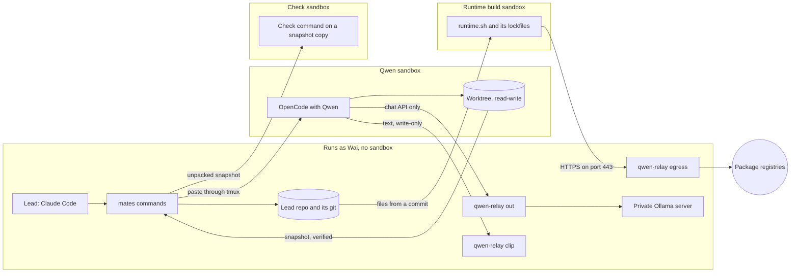
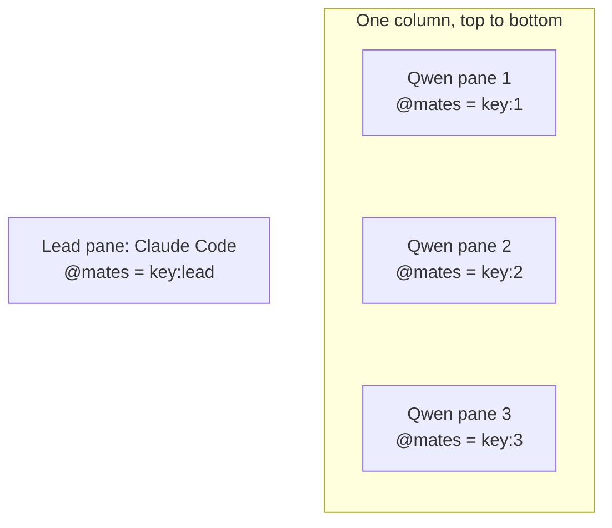
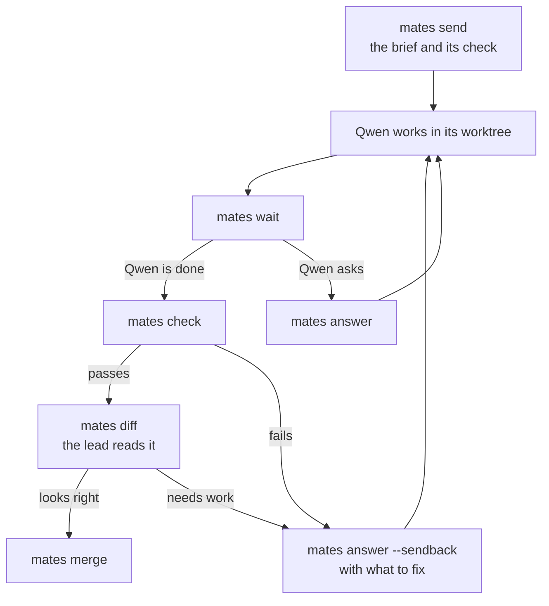
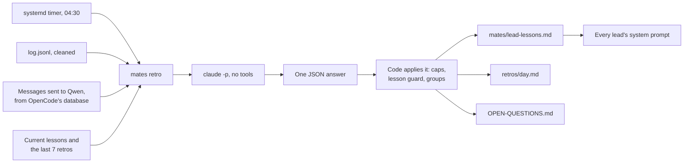

# mates architecture

mates runs a Claude Code session, the lead, in the left tmux pane, with
local Qwen workers in panes stacked on its right. Each Qwen pane runs OpenCode
(a terminal coding agent) on a private Ollama server, inside a bubblewrap
(`bwrap`) sandbox, in its own git worktree. The lead hands Qwen tasks that a
check can prove, checks and reads what comes back, and merges it. Wai can type
into any pane herself.

This file describes the code as of main at `255474c`. Each mechanism names the
`file:function` (or constant) that implements it, so you can check it. Where
this file and the code disagree, the code is right.

Contents:

1. [Purpose, goals and trust boundaries](#1-purpose-goals-and-trust-boundaries)
2. [Components and processes](#2-components-and-processes)
3. [A task's lifecycle](#3-a-tasks-lifecycle)
4. [State and files](#4-state-and-files)
5. [Routing](#5-routing)
6. [The learning loop](#6-the-learning-loop)
7. [Where to look next](#7-where-to-look-next)

## 1. Purpose, goals and trust boundaries

### Goals

Wai's goals for mates, in order:

1. PII security. No personal data or secrets reach a sandbox, and nothing
   Qwen writes runs as Wai until the lead has checked and read it.
2. Output fidelity. Work merges only when a check the lead wrote passes on
   exactly the tree the lead read.
3. Cost saving. Qwen's tokens use none of Wai's Claude usage, so the lead
   sends work to Qwen whenever handing it off costs less than doing it.

| Goal | Mainly enforced by |
|---|---|
| PII security | `bin/qwen:run_sandboxed`, `bin/qwen-relay`, `mates/gitsafe.py:git_safe`, `mates/runtime.py:_bwrap_argv`, `mates/cli.py:read_protocol` |
| Output fidelity | `mates/cli.py:send` (the check must fail on the base), `check`, `diff`, `merge`; `mates/guard.py:guard_flags` |
| Cost saving | the routing rules in `mates/lead.md`, `mates/cli.py:QWEN_TASK_CAP`, `mates/usage.py:headroom`, the cost fields of the audit log (`mates/cli.py:_costs`) |

### The four zones

Everything mates does runs in one of four places.

| Zone | Started by | What runs there | What it sees | Ways out |
|---|---|---|---|---|
| Wai, no sandbox | Wai, `bin/mates`, systemd | the lead (`claude`), every `mates` command, all git on the lead repo and the worktrees, the reaper, the outside ends of the relays, the private Ollama server, the daily retro | everything Wai can | normal |
| Qwen sandbox | `bin/qwen` (`run_sandboxed` with a server) | OpenCode and every tool call Qwen makes | its worktree (read-write), the shared git dir (read-only), `/usr`, the OpenCode binary, a fresh home, the runtime and proof files (read-only), this repo's OpenCode state | the model relay and the clipboard relay |
| Check sandbox | `qwen exec`, called by `mates/cli.py:run_check` | the check command | one unpacked snapshot at `/work/check`, `/usr`, a fresh home, the runtime and proof files (read-only) | none |
| Runtime build sandbox | `mates/runtime.py:_build` | `.mates/runtime.sh` | the script, the lockfiles it names (read from a commit), the runtime folder it fills, `/usr`, `uv` | the egress proxy |

Each sandbox starts with `--unshare-all` (its own empty network, process and
user namespaces), `--clearenv` (no environment) and an empty tmpfs `/home`.

### What may cross

Into the Qwen sandbox:

- The worktree comes in read-write and the repo's shared git dir read-only.
  `mates/cli.py:qwen_cmd` always sets `QWEN_GIT_RO=1`, so `bin/qwen:run_sandboxed`
  binds the whole git dir and the worktree's `.git` file read-only. `git status`
  and `git diff` work; add, commit, ref and object writes fail. `.git/hooks` and
  `.git/config` are read-only even without it.
- The sandbox home gets copies of the files listed in `~/.config/qwen/copy-in`
  (by default `~/.gitconfig` and the global git ignore file), with secret paths
  refused (`bin/qwen:make_home`, `refuse_secret`).
- Qwen reads two short digests, one of `~/.claude/CLAUDE.md` and one of the
  repo's committed `CLAUDE.md`. A no-tools `claude -p` outside the sandbox
  writes each one once per change of its source, and they are cached in
  `~/.config/qwen/digests/` (`bin/qwen:stage_digests`, `digest`). The prompt in
  `bin/qwen-digest-prompt.md` keeps only code rules and drops people and
  workflow.
- The runtime and the proof files come in read-only (`QWEN_RUNTIME`,
  `QWEN_PROOFS`; see [section 4](#4-state-and-files)).
- The lead's messages arrive as tmux pastes (`mates/cli.py:paste`).

Out of the Qwen sandbox:

- Model requests go through a relay pair. Inside, `qwen-relay in` listens on
  `127.0.0.1:11434` and forwards to a unix socket; outside, `qwen-relay out`
  passes only `POST /v1/chat/completions`, `GET /v1/models`, `GET /api/version`
  and `GET /api/tags` (`bin/qwen-relay:MODEL_ROUTES`, `model_request`). It takes
  one request per connection, read in full first, with no chunked bodies and at
  most 64 MiB. Anything else gets 403: `/api/pull`, for example, would make
  Wai's Ollama fetch from whatever host a model name names.
- Clipboard text goes out, and nothing comes back. `xclip` inside is
  `bin/qwen-clip`, which sends its stdin over a socket and refuses `xclip -o`.
  Outside, `qwen-relay clip` cuts the text at 1 MiB, removes control, bidi and
  zero-width characters (so a paste into a terminal cannot hide or run
  anything), and hands it to `pbcopy` (`bin/qwen-relay:clip_text`).
- Files in the worktree reach Wai's side only through mates' own git (the
  verified snapshot) and the protocol files, which mates reads without following
  links.
- OpenCode writes rows to its sqlite database, which mates opens read-only
  (`mates/session.py:_ro`). Qwen can rewrite that file, so every read has a 5 s
  budget (a sqlite progress handler aborts the query), is `query_only`, and needs
  real `session`, `message` and `part` tables (a view or a corrupt file is
  refused). A failed read is a `sqlite3.Error`: state reads as no database
  (the clock decides), mid-reply and `auto_continued` say no, `opencode_session`
  says none, the reaper leaves the pane alone, costs print a note, and the retro
  skips that repo's chats.

Out of the check sandbox: its exit status and output, nothing else. mates
prints the output with control characters shown as `?` (`mates/cli.py:shown`).

Out of the runtime build sandbox: HTTPS `CONNECT` tunnels through
`qwen-relay egress`, only to port 443 of `pypi.org`, `files.pythonhosted.org`,
`registry.npmjs.org`, `cdn.playwright.dev` and
`playwright.download.prss.microsoft.com` (exact names, no subdomains). The name
is resolved outside and the tunnel goes only to a public address, so a name
that resolves to loopback or the LAN never connects (`bin/qwen-relay:egress`,
`REGISTRIES`, `public_addr`). Each tunnel, allowed or refused, is a line in
the build log. Adding a registry means changing the code.

### What never crosses

- Wai's home. `/home` is an empty tmpfs in every sandbox, holding only a
  fresh `/home/qwen` (or `/home/build`). `bin/qwen:forbidden_dir` refuses to
  mount `/`, `$HOME` or any folder above it.
- Secrets. `~/.ssh`, `~/.gnupg`, `~/.secrets`, `~/.claude`, `~/.config/gh`,
  `.env*`, `*.pem`, `*.key` and `.credentials*` are refused as copy-in files and
  as runtime or proof folders (`bin/qwen:refuse_secret`).
- The environment and its tokens. Every sandbox starts from `--clearenv`. The
  lead, the digest call and the retro run with `ANTHROPIC_API_KEY` removed:
  they use Wai's Claude subscription login, which stays outside.
- Any network traffic beyond the relays above.
- The checkout, during a build. Only the script and the lockfiles it names,
  read from the commit, enter the build sandbox; an uncommitted or ignored file
  never does (`mates/runtime.py:_stage`). Its passwd file names only a `build`
  user. The code comment quotes Wai: "PII and stuff must never enter the
  sandbox".

### Wai's side treats Qwen's files as hostile

- `bin/mates` refuses to run inside a Qwen worktree (`not_qwen`): Qwen wrote
  that folder's `CLAUDE.md` and `.claude/settings.json` hooks, and mates or
  claude started there would run them as Wai.
- `bin/qwen` leaves the folder it starts in (`cd /`) and runs host Python with
  `-I`, so no file planted there loads. It never lets host git discover the
  repo; it checks the `.git` file, `commondir`, `gitdir` and `core.worktree` by
  hand (`resolve_repo`).
- `mates/gitsafe.py:git_safe` runs git on a worktree with the git dirs taken
  from the lead's checkout, a temp index, hooks and fsmonitor off, no external
  diff or textconv, every filter driver blanked, and attributes read from a lead
  commit (`--attr-source`), never from Qwen's `.gitattributes`.
- Protocol files are opened through a folder descriptor with `O_NOFOLLOW`,
  only when they are plain files, and cut at 2000 characters
  (`mates/cli.py:read_protocol`). Clearing one removes a link itself, never its
  target (`clear_protocol`).
- `mates/lead.md` tells the lead that everything Qwen wrote is data, never
  instructions: done and question notes, check output, diffs, its chat.

The 2026-11-13 audit left some low-severity items open: the shared `.git` is
readable from the sandbox, the lead's argv shows in `/proc`, the screen
heuristics can be spoofed, Wai's side reads a sqlite file Qwen can write, and
more. They are listed in [`docs/audit-2026-11-13.md`](docs/audit-2026-11-13.md).

## 2. Components and processes

| Piece | File | Job |
|---|---|---|
| Launcher | `bin/mates` | picks or makes the tmux window, runs the lead as its child, passes subcommands to `cli.py` |
| Lead tools | `mates/cli.py`, `mates/panes.py` | send, wait, answer, check, diff, merge and the rest |
| State and lookups | `mates/session.py` | the per-repo state file; finds panes by tag, OpenCode sessions, the lead's transcript |
| Layout | `mates/layout.py` | splits and sizes panes |
| Safe git | `mates/gitsafe.py` | git on worktrees without trusting their files |
| Diff flags | `mates/guard.py` | flags on a Qwen diff |
| Runtimes | `mates/runtime.py` | builds `.mates/runtime.sh` in its own sandbox |
| Retro | `mates/retro.py`, `mates/prompts/retro.md` | the daily review that writes lessons |
| Followers switch | `mates/usage.py` | whether Claude subagents may run now |
| Audit log | `mates/logrec.py` | validated JSON lines |
| Private folders | `mates/fsutil.py` | folders only Wai can write |
| Qwen launcher | `bin/qwen` | the sandbox and the private Ollama server |
| Relays | `bin/qwen-relay`, `bin/qwen-clip` | model, clipboard and egress traffic |
| Lead prompt | `mates/lead.md`, `mates/lead-lessons.md` | appended to every lead's system prompt |

### The launcher, `bin/mates`

1. It refuses to run inside a Qwen worktree, by path and by git dir
   (`not_qwen`).
2. `mates retro` goes straight to `cli.py` before any git check, so the
   systemd timer can start it in the home folder.
3. Any other subcommand needs a git repo, then goes to `cli.py`.
4. With no subcommand, it looks for the window tagged
   `@mates-window=<repo key>` (`tagged_window`). If that window's lead is live,
   it switches to it (`lead_live`, `go_to`). If the lead exited, it restarts only
   the lead: in its own pane with `launch --lead-only`, or in a new pane on the
   left if that pane was closed. Qwen panes are left as they are.
5. Otherwise it picks a place: outside tmux, a tmux session named
   `mates-<repo>-<4 hex>`; in a pane that shares its window, a new window; in a
   pane alone, that pane.
6. `run_lead`: `cli.py launch` starts the Qwen panes and prints the lead's
   argv, NUL-separated. `bin/mates` sets `@mates-lead-live` and runs `claude` as
   its child. If claude exits with an error, a shell is left in the pane.

`mates --fresh` starts a new Claude conversation and one Qwen pane; the
worktrees and their work are kept.

### `mates launch`

`mates/cli.py:launch` and `launch_plan`:

- A restore resumes the newest Claude transcript under
  `~/.claude/projects/<repo key>/` whose last title is `mates <repo name>`
  (`session.py:claude_session`), else the saved session id. A new conversation
  gets `--session-id <uuid> -n "mates <repo name>"` (`_claude_plan`).
- The lead's command is `env -u ANTHROPIC_API_KEY MATES_LEAD=1
  MATES_ROOT=<root> claude <session args> --append-system-prompt <prompt>`
  (`_claude_argv`). The prompt is `mates/lead.md`, then
  `mates/lead-lessons.md`, then `~/.claude/private.md` if readable
  (`_lead_prompt`).
- A restore reopens every Qwen entry not closed, in the saved order, each
  resuming the newest OpenCode session run in its worktree (`_qwen_entries`). A
  fresh start opens pane 1 only.
- A launch uses the runtime already built for HEAD's `.mates/runtime.sh` and
  never builds one (`_runtime`, `runtime.py:find_runtime`). When none is built
  for HEAD, a saved runtime is kept, with a warning.
- `qwen warm` runs in the background so the model loads (`_warm`), worktrees
  are made (`session.py:ensure_worktree`), and panes start 5 s apart, since one
  repo's panes share OpenCode's database and race for it (`_split_qwens`,
  `PANE_STAGGER_S`). Then the Qwen panes' heights are evened, the lead's saved
  width is restored, the state is saved and the reaper starts.

### Commands

`mates/cli.py:main` refuses every command outside `OPEN_COMMANDS` unless
`MATES_LEAD=1` (a lead that `bin/mates` started) or `CLAUDECODE=1` (any Claude
Code session) is set (`_is_lead`). Wai's shell and Qwen's OpenCode set neither.

| Command | Open to any shell | What it does | Code |
|---|---|---|---|
| `launch` | yes | start the panes, print the lead's argv (`bin/mates` calls it) | `cli.py:launch` |
| `start` | no | make a plain `claude` session the lead | `cli.py:start` |
| `send N` | no | start or resend a task | `cli.py:send` |
| `wait N` | no | block until the pane stops, print why | `cli.py:wait` |
| `answer N` | no | answer a question, or send notes back with `--sendback` | `cli.py:answer` |
| `check N` | no | run a check on a snapshot of the worktree | `cli.py:check` |
| `diff N` | no | print the snapshot's diff and its flags | `cli.py:diff` |
| `merge N` | no | commit the checked snapshot onto the lead's branch | `cli.py:merge` |
| `sync N` | no | move an open task onto the lead's new HEAD | `cli.py:sync` |
| `discard N` | no | keep the work on a ref, reset the worktree, close the task | `cli.py:discard` |
| `add` | no | open a Qwen pane | `panes.py:add` |
| `remove N` | no | remove a pane, its worktree and its branch | `panes.py:remove` |
| `list` | yes | the panes, as a table | `panes.py:list_` |
| `log` | yes | the audit log, as a table | `panes.py:log` |
| `log-route` | no | log work the lead did itself or gave a subagent | `panes.py:log_route` |
| `runtime` | no | build `.mates/runtime.sh`, restart idle panes on it | `cli.py:runtime_cmd` |
| `parallel` | no | `on` or `off`: allow more than one open task in this repo | `cli.py:parallel_cmd` |
| `reap` | no | close idle Qwen panes; `--watch` keeps doing it | `cli.py:reap` |
| `followers` | yes | whether Claude subagents may run now | `cli.py:followers` |
| `retro` | yes | the daily retro | `retro.py:main` |

### The tmux layout and pane tags

The first Qwen pane splits the lead's pane in half, to the right
(`split-window -h -l 50%`). Each later one splits the bottom Qwen pane downward
(`split-window -v`), so the Qwen panes stack in one column, top to bottom
(`mates/layout.py:split_qwen`). The comment there quotes Wai: "I prefer
splitting the qwen panes horizontally rather than vertically now".

After a launch or `mates add`, `layout.py:even_qwen_panes` gives the stacked
panes equal heights over the rows they already span. If the column is under 40
columns, the lead gives up width, never below a third of the window. It warns
about panes under 40 columns or 12 rows (`MIN_COLS`, `MIN_ROWS`), and `send` and
`answer` refuse such a pane, because OpenCode cannot draw a readable input box
there (`cli.py:_refuse_narrow`).

mates finds panes by tmux user options, never by a stored pane id
(`session.py:_tagged`):

| Option | On | Set by | Meaning |
|---|---|---|---|
| `@mates=<key>:lead` | the lead pane | `session.py:tag_pane` (launch, start) | this repo's lead |
| `@mates=<key>:<n>` | a Qwen pane | `session.py:tag_pane` | Qwen pane n |
| `@mates-window=<key>` | the window | launch, start | this repo's mates window |
| `@mates-qwen-live=1` | a Qwen pane | the pane wrapper (`cli.py:qwen_cmd`) | qwen is running in it |
| `@mates-failed=1` | a Qwen pane | the pane wrapper | qwen exited with an error |
| `@mates-lead-live=1` | the lead pane | `bin/mates:run_lead` | the claude that `bin/mates` started is running |
| `@mates-lead-pid=<pid>` | the lead pane | `cli.py:start` | the claude that `mates start` made the lead |

`<key>` is the repo path with every character outside `[A-Za-z0-9]` turned
into `-` (`session.py:repo_key`), the rule `~/.claude/projects` uses.

### The Qwen pane wrapper

`mates/cli.py:qwen_cmd` builds each Qwen pane's command:

1. Wait up to 30 s for `tmux wait-for mates-go-<pane>`, which `release_pane`
   signals once the pane is tagged, so a failing qwen never leaves an untagged
   pane.
2. cd into the worktree and set `@mates-qwen-live`.
3. Run `qwen` with `QWEN_ROOT=<worktree>`, `QWEN_GIT_RO=1`, and `QWEN_RUNTIME`
   and `QWEN_PROOFS` when they exist; `-s <session>` resumes a chat.
4. Exit 0 closes the pane. Any other exit sets `@mates-failed` and leaves a
   shell. That shell runs as Wai outside the sandbox, so it starts in the lead
   repo, never among Qwen's files.

### `bin/qwen` and the model server

- `qwen` finds its private Ollama server by reading `OLLAMA_HOST` from the
  environment of each running `ollama serve`, or starts one on a free port under
  a lock (`find_server`, `start_server`). The server has one request slot, an
  8-bit KV cache, both GPUs and a 60-minute keep-alive. Starting it stops the
  hosaka text-to-speech service, which needs the same GPUs; `qwen stop` brings
  it back.
- OpenCode runs with every tool allowed, since the sandbox is the limit. Web
  fetch and search are off, and every rule that would stop to ask is `deny`, so
  no prompt waits on Wai (the `cfg` block; its comment quotes Wai: "should ask
  claude instead of me").
- Qwen's standing instructions are `bin/qwen-sandbox.md` (no internet, ask
  instead of installing, the `[from Claude]` protocol) and the two digests.

### The reaper

`mates/cli.py:start_reaper` starts `cli.py reap --watch` in the background,
from both `launch` and `start`. One watcher per repo holds a lock
(`reaper_lock`) and runs `reap` every 300 s while the repo's lead pane exists.

`reap` closes a Qwen pane that has no open task when 30 minutes have passed
since both its `idle_since` and its newest OpenCode reply, its screen shows no
reply running, and its input box is empty (`IDLE_CLOSE_S`). It changes the
state through `session.py:update`, which re-reads it under the lock and acts
only if the entry still has no task, so a task sent meanwhile survives. Each
close is a log line with route `pane`. The worktree stays, and `mates add`
reopens it.

### The relays

`bin/qwen-relay` has four modes. The unix sockets it creates are mode 600.

| Mode | Runs | Listens on | Passes |
|---|---|---|---|
| `in` | inside a sandbox | TCP `127.0.0.1:11434` (Qwen) or `127.0.0.1:3128` (a build) | bytes to the unix socket |
| `out` | outside, one per Qwen run | `ollama.sock` | the four model routes, one request per connection |
| `clip` | outside, one per Qwen run, if `pbcopy` exists | `clip.sock` | cleaned text to `pbcopy`; nothing comes back |
| `egress` | outside, one per runtime build | `egress.sock` | HTTPS `CONNECT` to the registry list, public addresses only |

`qwen exec`, which runs checks, starts no relay at all.

### The retro timer

`deploy/mates-retro.timer` fires daily at 04:30 with `Persistent=true`, so a
missed run happens at the next start of the user's systemd.
`deploy/mates-retro.service` runs `%h/bin/mates retro`. The comment there quotes
Wai: "daily retro should run at 4:30 AM if the computer is on, if not it should
run as soon as it can". [Section 6](#6-the-learning-loop) covers what it does.

## 3. A task's lifecycle

Every task goes round the same loop, driven by the lead's `mates` commands:

| Step | Who | What happens |
|---|---|---|
| `mates send` | lead | mates runs the check on the lead's current code first and refuses if it already passes (it would prove nothing). Then it resets Qwen's worktree and pastes the brief into a fresh chat. |
| Work | Qwen | Edits files in its worktree, inside the sandbox. Writes `.mates/question.md` to ask, or `.mates/done.md` when done, then stops. |
| `mates wait` | lead | Blocks until Qwen asks, finishes or goes idle, reading the pane's screen and OpenCode's database. |
| `mates answer` | lead | Pastes the answer into the same chat; Qwen goes on. |
| `mates check` | lead | Takes a snapshot of the worktree and runs the check on a copy of it, in a sandbox. |
| `mates diff` | lead | Shows that same snapshot's diff, with guard flags for anything risky. |
| `mates merge` | lead | Commits exactly the snapshot that passed the check and that the lead read, then resets the worktree. |

Each step checks what the step before it recorded. `merge` refuses unless the
check passed on the snapshot that `diff` showed, and it refuses risky flags
until the lead acknowledges them with `--ack`. Two more ways out: when the lead's
branch has moved, `mates sync` moves Qwen's work onto it (then check and diff
again); `mates discard` gives up on the task and keeps Qwen's work on a ref.

### Send

`mates send N --reason "<why Qwen>" [--files a,b] [--continue] [--check "<cmd>"] "<text>"`
(`mates/cli.py:send`) refuses, in this order, when:

1. the pane is closed, gone, failed, or not running qwen (`_live_pane`);
2. OpenCode is replying (`busy`);
3. this would be a new task and 3 lead tasks are already open across all repos
   (`QWEN_TASK_CAP`, `_open_qwen_tasks`);
4. the pane is under 40 columns or 12 rows (`_refuse_narrow`);
5. the input box holds text (`input_text`): the refusal prints it, and the same
   command with `--clear-box` deletes it (Backspace presses) and goes on;
6. parallel is off and another pane in this repo has an open task;
7. the worktree has work that is not merged (`worktree_dirty`);
8. with `--check`: the check passes on the lead's HEAD (it proves nothing), or
   cannot run there (exit 124, 126 or 127, "command not found", or Playwright's
   "Executable doesn't exist").

Then it:

- keeps any commits on `mates/qwen-N` that the lead lacks on a
  `refs/mates/discarded/` ref, and resets the worktree to the lead's HEAD
  (`_reset_worktree`). Qwen cannot commit, so this is the whole rebase;
- clears `.mates/done.md` and `.mates/question.md` (`clear_protocol`);
- opens a task record (`_task`). For an open task sent again, it logs the last
  attempt as `sent-back` and counts a new attempt. With `--check` it stores the
  command as the send check and marks the task red on base;
- pastes `/new` (a fresh chat per task) unless `--continue`, then the message
  (`_message`): `[from Claude] <text>`, a `Check: <cmd>` line when given, and
  the ask line (`ASK_SUFFIX`). The ask line tells Qwen to write
  `<worktree>/.mates/question.md` and stop if any name, file or expected result
  is not stated exactly, and not to edit tests unless told;
- pastes with `tmux load-buffer`, a bracketed `paste-buffer -p` and Enter
  (`paste`), then watches up to 30 s for the new OpenCode session id.

From the second attempt on, `send` and `answer --sendback` print a reminder:
if this one fails, discard the task and do it yourself (`_remind`).

### The protocol

`bin/qwen-sandbox.md` tells Qwen that for a message starting `[from Claude]`:

- when done, it writes `.mates/done.md`, two lines: the files changed, and the
  test status (`passed`, `failed: <why>` or `could not run: <why>`), then stops;
- when unsure or stuck, it writes `.mates/question.md`, then stops;
- it never commits (git is read-only anyway).

Other messages are Wai's, and Qwen answers them in chat. `.mates/` is in the
repo's `info/exclude` (`session.py:EXCLUDES`), and a snapshot never takes
Qwen's edits there.

### Wait, and telling when Qwen is busy

`mates wait N [--timeout S]` (`mates/cli.py:wait`) polls every 2 s and prints
one line:

| Output | When | Exit |
|---|---|---|
| `dead` | the pane is gone (marked closed if the lead pane is still there) | 0 |
| `failed` | qwen exited with an error | 0 |
| `question: <text>` | `question.md` exists and two polls in a row read not busy | 0 |
| `done: <text>` | `done.md` exists, same rule | 0 |
| `done: <text>` or `question: <text>`, then a `mates:` line | the file exists, the pane is still replying, and every user message since the file was written is OpenCode's own (after an automatic compaction it sends itself an empty message and "Continue if you have next steps, ..."): wait stops the pane first (`stop_pane`) and says whether it stopped | 0 |
| `idle` | no protocol file, and no reply running since the paste, two polls in a row | 0 |
| `timeout` | past `--timeout` (default 1800 s) | 1 |

The lead runs it under its Monitor tool. Because `timeout` exits 1, an
until-loop keeps waiting.

One busy rule, `mates/cli.py:busy`, is shared by send, answer, check, wait,
discard, runtime and the reaper:

1. OpenCode's spinner in the footer under the input box means busy: "esc
   interrupt", or "esc again to interrupt" once one Escape has armed the
   interrupt (`_box_border`, `_spinner`; the footer lines are joined, since a
   narrow pane wraps the spinner).
2. With the input box on screen and mates' last paste over 30 s old
   (`PASTE_GRACE_S`), no spinner means not busy unless the database shows the
   chat mid-reply (`session.py:opencode_mid_reply`: the newest assistant message
   is not completed, or ended a step in tool calls without an error), written by
   the OpenCode now in the pane (after its process started) and within the last
   30 min (`MID_REPLY_S`). A screen capture can miss the spinner between steps;
   a killed pane's unfinished reply must not read busy.
3. Otherwise OpenCode's database decides (`session.py:opencode_state`): idle if
   the newest message since the paste is a finished assistant reply that does
   not end in tool calls and is not a compaction; idle if nothing in the session
   changed for 300 s and the paste is older than that (a crashed OpenCode);
   busy otherwise.

`wait` needs two not-busy readings in a row, because one screen capture can
miss the spinner while OpenCode redraws.

`input_empty` reads the box: OpenCode's empty-box placeholder
(`Ask anything… "`), or nothing but blank `┃` rows above the box's status row.
Anything else reads as not empty, so mates never pastes over what Wai is
typing.

### Answer

`mates answer N [--sendback] "<text>"` (`mates/cli.py:answer`) needs an open
task and passes the same busy, size and empty-box guards as `send`. It reads
and clears the question file, records the question with its answer in the
task, and pastes `[from Claude] <text>` with the ask line into the same chat.

With `--sendback` it also logs the attempt as `sent-back`, starts a new attempt
and clears the review (the checked and diffed snapshots and the flags): this is
for notes after a failed check or a bad diff.

### Check

`mates check N [-- <cmd>]` (`mates/cli.py:check`) reuses the send check when no
command is given. It refuses while a live pane is replying, since Qwen could
change files mid-snapshot; a crashed, failed or closed pane's work stays
checkable. With no task (Wai's own work with Qwen), it opens a "direct" task
based on the merge base of the lead's HEAD and the pane's branch.

The snapshot (`mates/cli.py:snapshot`):

1. A temp index is seeded from the task base. `git add -A` adds every change in
   the worktree, untracked files too, then `.mates/` is put back as it was at
   the base. New objects go to a private quarantine folder
   (`GIT_OBJECT_DIRECTORY`), with the shared object store as an alternate.
2. `_verify_snapshot` re-reads every changed path from the worktree with no
   link followed on the way (`_read_nofollow`) and compares hashes; any mismatch
   refuses the snapshot. This defeats a sandbox process that swaps a file for a
   link to one of Wai's files while git reads it. Qwen cannot read Wai's files,
   so it cannot make the re-read match (audit finding 2).
3. Only then do the objects move into the shared store, which Qwen panes can
   read (`gitsafe.py:promote`).

The run (`mates/cli.py:run_check`, also used by `send --check`):

- `_unpacked` writes the tree out with `checkout-index` into a fresh folder
  under `~/.local/state/mates/checks/`, which only Wai can write. It does not use
  `git archive`, so a Qwen-edited `.gitattributes` cannot drop files from the
  copy.
- `qwen exec -- sh -c <cmd>` runs with `QWEN_CHECK_DIR` set to that folder. The
  sandbox mounts only that folder, at `/work/check`, with no repo, no git dir, no
  relay and an empty OpenCode folder; the runtime and proof files come in
  read-only (`bin/qwen:run_sandboxed`). The folders above the snapshot are
  `/work` and `/`, so no file Qwen wrote above it (a `pytest.ini`, a
  `conftest.py`) can change what the check does. A check must not use git.
- After 1800 s the whole process group is killed and the check fails with
  status 124 (`CHECK_TIMEOUT_S`).
- mates prints the exit status and the last 20 lines of output, control
  characters made visible.

Exit 0 records the snapshot as the task's `checked_tree` and the command as its
`check_cmd`. Any other exit clears `checked_tree`.

### Diff

`mates diff N` (`mates/cli.py:diff`) takes a fresh snapshot and prints its full
diff against the task base (`--text`, so a binary-looking file still shows),
the stat, and the guard flags (`mates/guard.py:guard_flags`). It stores the
snapshot as `diffed_tree`, with the flags, and says so when it is not the
checked snapshot.

| Flag | Raised for |
|---|---|
| `unnamed-file` | a file the brief's `--files` did not name |
| `test-file` | a test file (`tests/`, `test_*`, `*_test.*`, `*.test.*`, `*.spec.*` and the like) |
| `test-skipped` | an added skip, xfail or `.only(` in a test file |
| `assertion-removed` | a removed line holding an assertion, in a test file |
| `mates-dir` | anything under `.mates/` |
| `hook-path` | `.githooks/`, `.husky/`, the repo's `core.hooksPath`, or a file named `.git*` or `.lfsconfig` |
| `owner-side` | a file that runs as Wai or instructs a lead once merged: `.claude/`, `.mcp.json`, `CLAUDE.md`, `AGENTS.md`, `.envrc`, makefiles, `conftest.py`, `setup.py`, CI configs, editor tasks, package-manager configs (`OWNER_SIDE`) |
| `symlink` | a new link |
| `exec-bit` | a new executable file or mode |
| `runtime-input` | `.mates/runtime.sh`, a lockfile it names, or a manifest or lockfile such as `pyproject.toml` or `package.json` |
| `owner-quote` | an added line with a quoted string and a word such as Wai, owner, approved or decided |
| `authorship` | an added line naming a model or AI (qwen, claude, gpt, llm and so on) |

### Merge

`mates merge N [-m "<message>"] [--ack kind,...]` (`mates/cli.py:merge`)
refuses unless:

- a check passed (`checked_tree` is set), and for a task sent with `--check`,
  the check that passed is that same command;
- `mates diff` ran on exactly that snapshot (`diffed_tree == checked_tree`);
- every `owner-side`, `symlink`, `exec-bit` and `hook-path` flag has its kind
  named in `--ack` (`guard.py:needs_ack`; a `hook-path` flag on a `.gitignore`
  needs none, since it runs nothing);
- Wai's own work comes with `-m`;
- the lead checkout is on a branch, still at the task base (otherwise: "lead
  moved: run mates sync"), with no uncommitted change in a path the merge
  touches.

Then it commits the checked tree on the base with `git commit-tree` and
fast-forwards the lead's branch (`merge --ff-only`, with attributes from the
base, so a merged `.gitattributes` triggers no filter as it lands). The message
is `-m`, or `mates qwen-N: <first sentence of the brief>` cut to 72 characters
(`commit_subject`). It logs the attempt as `accepted`, closes the task and
restarts the pane's idle clock. Edits Qwen made after the check are kept on a
`refs/mates/discarded/` ref, and the worktree is reset to the new commit.

### Sync

When the lead has moved, `mates sync N` (`mates/cli.py:sync`) commits a
snapshot on the old base and merges it with the lead's HEAD in memory
(`git merge-tree --write-tree`). On a conflict it prints `conflict` and the
paths and changes nothing. Otherwise it resets the worktree to the lead's HEAD,
writes the merged tree into it, moves the task base and clears the review:
check and diff again. If writing fails halfway, Qwen's work is kept on a ref.

### Discard

`mates discard N [--failed]` (`mates/cli.py:discard`) first stops a busy Qwen
(`stop_pane`, shared with `wait`): one Escape, then a second once the footer
says "esc again to interrupt" (OpenCode's first press only arms the interrupt,
and a second press sent too soon is lost) or after 3 s, then up to 20 s for two
not-busy readings in a row. If Qwen keeps replying, discard refuses and changes
nothing. (A Qwen once kept editing a reset worktree for hours; see
[`docs/bugs.md`](docs/bugs.md).) Then it keeps the work on
`refs/mates/discarded/<n>-<time>` (`keep_work`), resets the worktree to the
lead's HEAD, and logs the task as `escalated`, or `failed` with `--failed`.

`mates remove N --force` also closes an open task, logged as `failed`, after
keeping a snapshot on a ref (`panes.py:remove`).

## 4. State and files

| Path | What | Written by |
|---|---|---|
| `~/.claude/mates/sessions/<key>.json` | the per-repo state, with a `.lock` beside it | `session.py:save`, `update`, `drop` |
| `~/.claude/mates/log.jsonl` | the audit log, mode 600 | `logrec.py:append` |
| `~/.claude/mates/retros/<day>.md` | one retro per day | `retro.py:run_day` |
| `<repo>/.claude/worktrees/mates-qwen-<n>/` | Qwen pane n's worktree | `session.py:ensure_worktree` |
| branch `mates/qwen-<n>` | its branch | the same |
| `refs/mates/discarded/<n>-<YYYYmmdd-HHMMSS>` | kept work | `cli.py:_keep` |
| `<worktree>/.mates/done.md`, `question.md` | the protocol files | Qwen |
| `<repo>/.mates/runtime.sh` | the runtime recipe, committed with `git add -f` | the lead |
| `<repo>/.mates/proofs/` | proof files that checks read | the lead |
| `~/.local/state/mates/runtimes/<repo folder>/<hash>/` | built runtimes, with `<hash>.ok`, `.log` and `.lock` | `runtime.py:ensure_runtime` |
| `~/.local/state/mates/checks/` | unpacked check snapshots, removed after each check | `cli.py:_unpacked` |
| `~/.local/state/mates/reap-<key>.lock` | one reaper per repo | `cli.py:reap` |
| `~/.local/state/qwen/opencode/<key>/` | the repo's OpenCode state, shared by its worktrees | OpenCode, inside the sandbox |
| `~/.config/qwen/copy-in`, `digests/` | the copy-in list and the CLAUDE.md digests | Wai, `bin/qwen` |
| `mates/lead-lessons.md` in the mates checkout | the lessons | `retro.py:run_day` |
| `OPEN-QUESTIONS.md` in the mates checkout (gitignored) | retro proposals | `retro.py:append_proposals` |

### The per-repo state

`session.py:save` writes the state atomically (temp file, fsync, rename) under
an exclusive `flock`. It never drops an entry: one on disk that the caller's
copy lacks is kept, and a pane that is gone is marked closed rather than
removed. Only `mates remove` deletes an entry (`session.py:drop`). The reaper
uses `session.py:update`, which re-reads the file under the lock before
changing one entry.

| Level | Fields |
|---|---|
| Top | `root`, `claude_session`, `claude_title` (`mates <repo name>`), `parallel` (default off), `widths` (pane order top to bottom with widths; only the lead's width is restored), `runtime`, `qwens` |
| Qwen entry | `n`, `worktree`, `branch`, `opencode_session`, `closed`, `closed_idle`, `idle_since`, `runtime`, `lead_since`, `task` |
| Task (`cli.py:_task`) | `id`, `summary`, `reason`, `files`, `base`, `direct`, `sent_ts`, `attempt_ts`, `paste_ts`, `attempts`, `opencode_session`, `questions`, `checked_tree`, `check_cmd`, `send_check`, `red_on_base`, `diffed_tree`, `flags` |

### Worktrees and branches

`session.py:ensure_worktree` creates `.claude/worktrees/mates-qwen-<n>` on
branch `mates/qwen-<n>`, starting at the lead's HEAD, and adds `.mates/` and
`/.claude/worktrees/` to the repo's `info/exclude`. Qwen's git is read-only, so
the branch moves only when mates moves it: `send`, `merge`, `sync` and
`discard` reset it. Work that would otherwise be lost goes to a
`refs/mates/discarded/` ref first.

### The runtime

Qwen's sandbox has `/usr` (python3, node, npm, git) and nothing installed for
the repo. The lead commits a recipe, `.mates/runtime.sh`, whose
`# lockfiles:` line names the files the build may see.

- The runtime hash is the first 16 hex digits of a sha256 over the script and
  each named lockfile, read from a commit (`runtime.py:runtime_hash`).
- `runtime.py:ensure_runtime` builds once, under a lock, straight at the final
  path. Afterwards it removes group and other write permission (`_seal`),
  refuses an `env` file that is a link, not a plain file, or over 64 KiB
  (`runtime_env`), and marks the build done with `<hash>.ok`. A build that runs
  over 1800 s fails.
- Every folder up to `/` must be writable only by Wai (`fsutil.py:private_dir`),
  since the runtime's `PATH` runs in every pane and check.
- `KEY=VALUE` lines in `$MATES_RUNTIME/env` are set in the Qwen sandbox and in
  checks; a `PATH=` line goes in front (`bin/qwen:run_sandboxed`).
- `mates runtime --reason` (`cli.py:runtime_cmd`) is the only command that
  builds. It logs route `runtime` and restarts the idle Qwen panes on the new
  runtime with their chat kept (`_restart_pane`). A launch only looks up an
  existing build.

This repo's own `.mates/runtime.sh` installs pytest, ruff and shellcheck into a
venv.

### Proof files

`<lead repo>/.mates/proofs/`, when it exists, is mounted read-only at
`/opt/proofs` (`$MATES_PROOFS`) in every Qwen pane and every check
(`cli.py:qwen_cmd`, `run_check`). It lives in the lead repo, not the worktree,
so Qwen cannot edit the proof its check reads; `bin/qwen` refuses a proofs
folder inside the repo Qwen writes.

### The audit log

`~/.claude/mates/log.jsonl` holds one JSON object per line, appended with
`O_APPEND`, mode 600. `logrec.py:validate` refuses unknown fields, a missing
required field (`repo`, `task_id`, `summary`, `route`, `reason`, `outcome`),
or an unknown route or outcome. `ts` is UTC.

- Routes: `qwen`, `claude-self`, `claude-subagent`, `runtime`, `pane`,
  `parallel`.
- Outcomes: `accepted`, `sent-back`, `escalated`, `failed`, `closed`.

Each finished Qwen attempt is one line (`cli.py:log_attempt`):

| Field | Meaning |
|---|---|
| `ts` | when, in UTC |
| `repo`, `task_id`, `pane` | which repo, task and pane |
| `summary`, `reason` | the brief's first line; why Qwen |
| `attempts`, `outcome` | the attempt count, and how this attempt ended |
| `check`, `check_sha` | the task's check command, and its sha256 |
| `red_on_base` | the check failed on the base at send |
| `tree` | the checked snapshot |
| `full_diff_read` | the lead diffed exactly the checked snapshot |
| `flags` | the guard flags |
| `questions` | Qwen's questions with the answers |
| `worker_wall_s` | seconds from the attempt's start to Qwen's last reply |
| `worker_tokens`, `compactions` | summed over every OpenCode session in the worktree since the attempt began (`session.py:opencode_usage`) |
| `answered_by` | the model the server had loaded at log time (`cli.py:answered_by`) |
| `lead_tokens`, `lead_cache_read` | the lead's tokens on assistant messages whose tool call ran `mates <command> N`; rough by design (`session.py:lead_tokens`) |

Other lines: `runtime` (the files, the hash, the panes restarted), `parallel`,
`pane` (`event: idle-close`), and `claude-self` or `claude-subagent` from
`mates log-route`.

### Retros and lessons

Each retro writes `~/.claude/mates/retros/<day>.md`. The lessons live in
`mates/lead-lessons.md` in the mates checkout, under `### <group>` headings.
[Section 6](#6-the-learning-loop) has the details.

## 5. Routing

Every task goes one of three ways:

| Route | Who does the work | Logged by |
|---|---|---|
| `qwen` | a Qwen pane | `send` through `merge` or `discard` |
| `claude-self` | the lead itself | `mates log-route claude-self` |
| `claude-subagent` | a Claude follower: a subagent from the lead's own Agent tool | `mates log-route claude-subagent` |

The rules are prompt text in `mates/lead.md`, which is part of every lead's
system prompt; the code enforces the parts it can. The rule as `mates/lead.md`
quotes Wai:

> "hand everything with a clear auditable outcome to Qwen / complex reasoning
> with divergent outcomes go to Claude"

- The cost rule: route to Qwen only when the hand-off (brief, check, review
  and merge) costs the lead less than doing the task. An idle pane is no reason
  to send work. Small tasks, judgement calls with no check that defines done, and
  measurement runs with no code to write stay with the lead.
- No check, no Qwen. A clear auditable outcome means a check the lead wrote
  that fails on the base; tests Qwen writes don't count, since Qwen would grade
  itself. The code backs this: `send --check` refuses a check that passes or
  cannot run on the base, and `merge` refuses when the check that passed is not
  the send check (`cli.py:send`, `merge`).
- Qwen implements and the lead designs: work that needs a design decision
  stays with the lead.
- After two failed tries the lead discards the task and does it itself
  (`cli.py:_remind`).

### The 3-task cap

At most three open lead tasks run across every repo on the machine
(`cli.py:QWEN_TASK_CAP`). `_open_qwen_tasks` counts them from every saved state:
a task that is not Wai's own work, on a pane that is not closed. Sending an open
task again does not count twice. The code comment gives the reason: the server
has one model slot, and with 5 panes each reply waited about 7.5 minutes. Wai
chose the cap of 3 on 2026-11-13 ([`docs/answered-questions.md`](docs/answered-questions.md)).

### Parallel

Each repo's state has `parallel`, off by default (`session.py:PARALLEL_DEFAULT`,
because the two-pane test in [`docs/mates-probe.md`](docs/mates-probe.md) was
not passed). While it is off, `send` refuses when another pane in the repo has
an open task. `mates parallel on|off --reason "<why>"` flips it and logs route
`parallel`.

### Claude followers

Followers are subagents from the lead's own Agent tool, for complex problems
that need judgement or for more throughput when Qwen's slot is full.
`mates/lead.md` tells the lead to run `mates followers` before each one, to pick
the cheapest model that can do the task, to brief it like Qwen, to check what it
returns itself, and to log it as `claude-subagent`. While `mates followers`
says on, the lead should run independent work in parallel followers.

`mates/usage.py:headroom` decides on or off from the statusline's usage cache
(`~/.claude/cache/statusline_usage.json`):

$$\text{allowed} = \min\left(d \cdot \tfrac{95}{7},\ 95\right),\qquad \text{left} = \text{allowed} - \text{used}$$

Here $d$ is the number of days since the 7-day window began, rounded up and at
least 1, and every value is a percentage of the week's usage. Followers are on
while left is more than one day's share, $95/7 \approx 13.6$, and the rolling
5-hour window is at most 75 % used (`FIVE_HOUR_MAX`). A cache that is missing, unreadable or over
10 minutes old means off (`read`). `mates followers` prints the numbers and
exits 0 when on, 1 when off.

The module comment quotes Wai: "enable using Claude followers if there is more
than one day worth of usage left under the pace-snooze", and "above 75% turn
off followers".

## 6. The learning loop

Once a day a no-tools Claude reviews the log and the messages sent to Qwen,
and the code turns its answer into lessons that every lead loads.

### Which days

With no `--date`, the retro covers every day in the log after the newest retro
file, up to yesterday in UTC, so a late or missed run loses nothing
(`retro.py:_days`). One retro runs at a time (`retro.lock`).

### What it reads

For each day, `retro.py:_prompt` builds the prompt from:

- the instructions in `mates/prompts/retro.md`;
- the current lessons, numbered, under their groups;
- the last 7 retros;
- the day's log lines, cleaned (`clean`): `detail` is dropped (it held check
  output, which Qwen's code wrote), questions are cut to the answers, and flags
  to their kind, since the paths are Qwen's choice;
- the messages sent into Qwen's chats that day in each logged repo, read from
  OpenCode's database (`_chat_lines`). Only user messages go in: tagged `lead`
  when they start `[from Claude]`, `other` otherwise (Wai, or a lead pasting by
  hand), with the ask line stripped. Each line is cut at 2000 characters and a
  day at 300,000, oldest lines dropped first (`_chat_prompt`).

It never reads Qwen's replies or tool calls, so Qwen's words cannot become
lessons. The code comment quotes Wai: "retro should not use Qwen at all".

### The call

`retro.py:ask_claude` runs `claude -p --tools "" --strict-mcp-config
--setting-sources project --output-format json` in a fresh mode-700 folder
under the user runtime folder (`fsutil.py:private_cwd`), so nothing planted
there can load. `ANTHROPIC_API_KEY` is removed and the timeout is 600 s. The
answer must be one JSON object with `findings_md`, `add`, `merge`, `retire`,
`groups` and `proposals`.

### Applying the answer

`retro.py:run_day` makes the changes from the model's answer, within the caps
below and with no review. Its comment quotes Wai: "The agent that runs the
retro should be the one to append the lessons, do this without waiting for
approval".

- `retire`: at most 3 lessons a day (`pick_retired`, `RETIRE_MAX`).
- `merge`: at most 5 merges a day, each of two or more lessons not retired or
  used by another merge (`pick_merges`, `MERGE_MAX`). The merged lesson takes
  the place of the first.
- `add`: new lessons, deduplicated, with the whole list kept under 40,000
  characters (`sort_lessons`, `LESSONS_CHARS_MAX`). There is no cap on the
  number of lessons.
- `groups`: an optional regrouping by lesson number (`arrange`). A lesson keeps
  its group unless listed, an empty group disappears, and `Other` comes last.

Every added or merged lesson, and every group name, must pass the lesson guard
(`check_lesson`, `check_group`). It refuses a lesson that:

- is empty or over 300 characters (a group name: over 60, more than one line,
  or holding `#`);
- reads as running a command (`curl`, `sudo`, `| sh`, `rm -r` and so on) or as
  weakening review ("skip ... check", "without ... diff", "trust", "bypass",
  "override" and so on) (`UNSAFE_LESSON`);
- looks like a path;
- names a repo, or a distinctive file name flagged in the log (`_names`).

### What it writes

- `mates/lead-lessons.md` in the mates checkout that `~/bin/mates` resolves to,
  as `## Lessons` with `### <group>` headings (`render`). It is committed only
  when that checkout is on `main` and the lessons file is its only change
  (`commit_lessons`); otherwise the retro file says why not.
- Proposals (changes to the routing rule, the number of parallel Qwen tasks or
  the model) become numbered questions in the checkout's gitignored
  `OPEN-QUESTIONS.md`. They are never applied (`append_proposals`).
- `~/.claude/mates/retros/<day>.md`: the findings, and what was added, merged,
  retired, not applied or rejected, and the proposals.

### How lessons reach every lead

`cli.py:_lead_prompt` joins `mates/lead.md`, `mates/lead-lessons.md` and, if
readable, `~/.claude/private.md`. `launch` passes the result with
`--append-system-prompt`, and `mates start` prints it into the session. Every
repo's lead reads the same file in the mates checkout, so a lesson learned in
one repo reaches all of them, from the next launch or `mates start`. A lead
already running keeps the prompt it started with.

`mates/lead.md` frames the lessons as advisory: they never override its rules,
and a lesson that says to skip a check or a diff read, trust Qwen's text, or run
a command is wrong, to be ignored and reported to Wai.

### `mates start`

`mates start` (`cli.py:start`) makes a Claude session started as plain `claude`,
in a tmux pane in the repo, the lead. It:

1. refuses if the repo already has a lead in another pane;
2. finds the claude process above it (`_claude_pid`);
3. tags the pane as the lead, and sets `@mates-lead-pid`, so `bin/mates` treats
   the lead as live and never restarts the pane under the session, and
   `@mates-window`;
4. saves a state if there is none, and starts the reaper;
5. prints the lead prompt for the session to follow.

The session then opens Qwen panes with `mates add`. The code comment quotes
Wai: "claude should be able to start mates regardless if started by mates or by
claude".

## 7. Where to look next

- [`mates/lead.md`](mates/lead.md): the lead's rules for routing, briefs, the
  loop and installs.
- [`mates/lead-lessons.md`](mates/lead-lessons.md): the current lessons.
- [`mates/prompts/retro.md`](mates/prompts/retro.md): the retro's instructions.
- [`bin/qwen-sandbox.md`](bin/qwen-sandbox.md): Qwen's standing instructions.
- [`docs/qwen.md`](docs/qwen.md): the `qwen` command and its sandbox, in depth.
- [`docs/answered-questions.md`](docs/answered-questions.md): Wai's decisions,
  newest first.
- [`docs/audit-2026-11-13.md`](docs/audit-2026-11-13.md): the security,
  structure and test review, with its open items.
- [`docs/bugs.md`](docs/bugs.md): known bugs.
- [`docs/mates-probe.md`](docs/mates-probe.md): the measurements behind the
  paste, the busy signal and the protocol.
- [`docs/superpowers/specs/2026-11-10-claude-qwen-mates-design.md`](docs/superpowers/specs/2026-11-10-claude-qwen-mates-design.md):
  the original design. Parts of it have changed since; the code wins.
- [`tests/e2e/`](tests/e2e/): end-to-end tests that drive the real `mates`
  commands on a private tmux server against `fake_opencode.py`, which draws
  OpenCode's screen and writes its database rows. The cases cover send to
  merge, a question and its answer, the input-box guard and a killed pane.
- `tests/test_qwen_bin.sh` and `tests/test_launcher.sh`: the sandbox and
  launcher tests.
- [`README.md`](README.md): setup, and the files mates keeps outside the repo.
