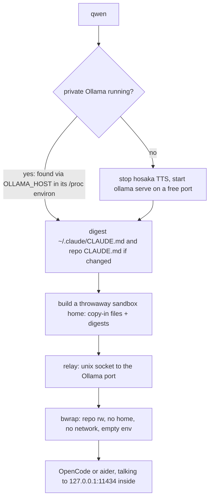

# `qwen`: the local coding model, sandboxed

`qwen` runs a coding agent on the local model, in the git repo you are in,
inside a bubblewrap sandbox. Source: `bin/qwen` (and `bin/qwen-relay`,
`bin/qwen-digest-prompt.md`); `qwen --help` prints the rules.

```
qwen                 # OpenCode
qwen aider           # aider instead
qwen server          # start or find the private Ollama server, print its address
qwen stop            # stop it, restart hosaka TTS
qwen sandbox-test    # show what the sandbox can and cannot reach
qwen shell           # a bash inside the sandbox (no agent), to look around
```

Environment overrides: `QWEN_MODEL` (default
`qwen3.8-27b-turbo-heretic:mtp-iq4xs`), `QWEN_CTX` (default 65536),
`QWEN_OPENCODE` (path to the OpenCode binary).

## What happens when you run it



## The sandbox

| Inside the sandbox | Result |
|---|---|
| the current git repo | read-write (it has to edit code) |
| the repo's git dir, if it lives elsewhere (submodule, worktree) | read-write |
| `.git/hooks`, `.git/config` | read-only, so nothing written can run later outside |
| your home folder (`~/.ssh`, `~/.claude`, other repos) | not there |
| the network | none; a unix socket to Ollama is the only way out |
| environment | empty plus basics (`HOME`, `PATH`, `TERM`, `LANG`, Ollama address); no tokens |
| `/usr`, the OpenCode binary, the aider venv | read-only |
| user | you (`wai`), so files it writes are yours |
| your terminal | kept attached, so resizing the pane resizes the agent; safe because this kernel blocks terminal keystroke injection (`dev.tty.legacy_tiocsti = 0`). If that setting is ever on, `qwen` detaches the terminal and warns |

OpenCode runs with every tool allowed (no approval prompts). Web fetch is
denied, and there is no network anyway. The sandbox is the guard.
When Qwen needs a web page or docs it asks (in chat, or in
`.mates/question.md` for a task from the Claude lead), and the lead fetches
and answers. Every URL goes past a reviewer, so nothing in the repo can leak
out through a request.

Limits worth knowing:
- **The repo itself is writable.** Bad code planted in a test or script runs as
  you the next time you run it outside the sandbox. Review diffs before running
  them.
- **It runs as you, not as a separate user.** A kernel-level escape from bwrap
  would land as `wai`. (The mates workers also switch to user `claude`.)
- **Other repos are invisible,** even a parent repo (for example `exec-fn` when
  you work in its `spire` submodule).

## Giving it more files: `~/.config/qwen/copy-in`

At every launch, the files listed there are copied into the sandbox's
throwaway home. One per line:

```
~/.gitconfig
~/.config/git/ignore:.config/git/ignore     # <source>:<path inside the sandbox home>
```

Add a line when the agent needs a file from your home. Secret paths are
refused even if listed: `~/.ssh`, `~/.gnupg`, `~/.secrets`, `~/.claude`,
`~/.config/gh`, and files named `.env*`, `*.pem`, `*.key`, `.credentials*`.

## Standing instructions: CLAUDE.md digests

The full CLAUDE.md files are long and mostly about Claude's own tools, so
`qwen` gives the model short digests instead (at most about 300 words each):

- one of `~/.claude/CLAUDE.md`, keeping only rules that apply to every repo;
- one of the repo's `CLAUDE.md`: commands, conventions, hard code rules.

Claude writes each digest with one small `claude -p` call the first time a
CLAUDE.md is seen or after it changes. The instructions it follows are in
`bin/qwen-digest-prompt.md`. Digests are cached in
`~/.config/qwen/digests/<hash>.md` and never written into the repo. To see
what the model gets: `cat ~/.config/qwen/digests/*.md`. If the Claude login has
lapsed, the digest is skipped with a warning and `qwen` runs without it.

## Where state lives

| Path | What |
|---|---|
| `~/.local/state/qwen/serve.log` | private Ollama server log |
| `~/.local/state/qwen/opencode/` | OpenCode sessions (persist between runs) |
| `~/.local/state/qwen/aider/` | aider history, cache and model settings |
| `~/.config/qwen/copy-in` | files copied in |
| `~/.config/qwen/digests/` | CLAUDE.md digests |

## Switching models

Try one for a session:

```
QWEN_MODEL=qwen3.6:35b-a3b QWEN_CTX=131072 qwen
```

The default is the `MODEL=` line near the top of `bin/qwen`. To add a new
model, see "Rebuilding a model" in `docs/models.md`.

## Known quirks

- **It may say it is Claude.** The TURBO merge was partly trained on Claude
  Opus outputs.
- **The first reply after a cold start is slow** while the model loads (17 GB)
  and reads the agent's system prompt.
- **OpenCode works offline,** with update checks, model-catalog fetch, plugin
  and LSP downloads all turned off. If it ever errors about a missing provider
  package, it is trying to download one and the sandbox blocks it.
