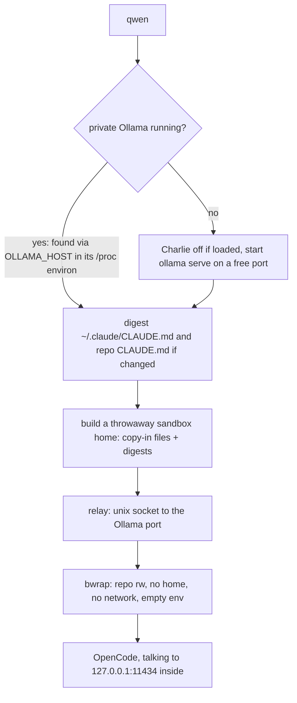

# `qwen`: the local coding model, sandboxed

`qwen` runs a coding agent on the local model, in the git repo you are in,
inside a bubblewrap sandbox. Source: `bin/qwen` (and `bin/qwen-relay`,
`bin/qwen-clip`, `bin/qwen-digest-prompt.md`); `qwen --help` prints the rules.

```
qwen                 # OpenCode
qwen exec -- <cmd>   # run <cmd> in the sandbox, return its exit code (no server, no model)
qwen server          # start or find the private Ollama server, print its address
qwen host            # print the running server's address, or exit 1 (never starts one)
qwen warm            # start or find the server and load the model in the background
qwen stop            # stop it; Charlie back if homo was asked
qwen opencode-dir    # print this repo's OpenCode state folder
qwen sandbox-test    # show what the sandbox can and cannot reach
qwen shell           # a bash inside the sandbox (no agent), to look around
```

`qwen exec` is what `mates check` uses to run a Qwen worktree's tests: the same
mounts as an agent run, but no Ollama server, no relay (not even the clipboard
one), and no GPU lock of its own, so a check never loads the GPU or touches hosaka.

aider is gone (Wai retired it, 2026-11-10); OpenCode is the only agent.
`~/.local/state/qwen/aider/` from earlier runs is left where it is.

Environment overrides:

| Variable | Effect |
|---|---|
| `QWEN_MODEL` | model (default `qwen3.8-27b-turbo-heretic:mtp-iq4xs`) |
| `QWEN_CTX` | context length OpenCode is told (default 65536) |
| `QWEN_OPENCODE` | path to the OpenCode binary |
| `QWEN_GIT_RO=1` | the whole git folder and a worktree's `.git` file are read-only: `git status` and `git diff` work; add, commit, ref and object writes fail, and the worktree cannot be pointed at another git folder. mates panes and `mates check` always set it. Any value but empty or `0` turns it on |
| `QWEN_ROOT=<dir>` | the repo top to mount, instead of finding it from the current folder; the current folder must be inside it. mates sets it for every launch and check |
| `QWEN_RUNTIME=<dir>` | `<dir>` is mounted read-only at the same path; its `env` file's `KEY=VALUE` lines (same filter as `mates/runtime.py`) are set inside, and a `PATH=` line goes in front of the sandbox PATH. A folder holding your home, or a secret path, is refused |

## What happens when you run it



## The sandbox

| Inside the sandbox | Result |
|---|---|
| the current git repo | read-write (it has to edit code) |
| the repo's git dir, if it lives elsewhere (submodule, worktree) | read-write (read-only with `QWEN_GIT_RO=1`) |
| `.git/hooks`, `.git/config` | read-only, so nothing written can run later outside |
| with `QWEN_GIT_RO=1`: the whole git dir, a worktree's `.git` file | read-only |
| other repos' OpenCode sessions | not there: each repo has its own folder |
| your home folder (`~/.ssh`, `~/.claude`, other repos) | not there |
| the network | none; a unix socket to Ollama is the only way out |
| the clipboard | write-only: `xclip` inside (what OpenCode copies with) hands the text over a socket to `pbcopy` outside; reading it is refused, so paste with the terminal (Ctrl+V). Not there in `qwen exec` |
| environment | empty plus basics (`HOME`, `PATH`, `TERM`, `LANG`) and the OpenCode settings; no tokens |
| `/usr`, the OpenCode binary | read-only |
| user | you (`wai`), so files it writes are yours |
| your terminal | kept attached, so resizing the pane resizes the agent; safe because this kernel blocks terminal keystroke injection (`dev.tty.legacy_tiocsti = 0`). If that setting is ever on, `qwen` detaches the terminal and warns |

**How the repo is found.** `qwen` never runs git on the host to find the
repo, because a `.git` file or git config that Qwen planted in a folder it can
write (such as `.mates/`, where `mates check` runs) would point git at the lead's
checkout or at your home. The top is `QWEN_ROOT`, or else the nearest folder
above with a `.git` (refused inside any `.mates` folder). It refuses when:
`.git` is a symlink; a `.git` file points anywhere but this checkout's own
worktree folder (whose `gitdir` file must point back) or a submodule git dir;
`core.worktree` anywhere names a folder other than the top; a git config uses
`include`; or the top or a git dir is `/`, your home or above it, or a secret path.

OpenCode never stops for an approval prompt: no prompt may wait on Wai. Edits
and shell are allowed. Everything OpenCode would otherwise ask about is denied:
paths outside the repo and `/tmp`, reading `.env` files, a repeated identical
call, its question tool and plan mode. Web fetch is denied, and there is no
network anyway. A refused call tells Qwen to ask instead (the lead, in
`.mates/question.md`, for a mates task). The sandbox is the guard; these rules
only keep Qwen from waiting on a human.
When Qwen needs a web page or docs it asks (in chat, or in
`.mates/question.md` for a task from the Claude lead), and the lead fetches
and answers. Every URL goes past a reviewer, so nothing in the repo can leak
out through a request.

All panes share the private server's one slot, so a request can wait behind
another pane's reply, which takes 6 to 11 minutes at about 5 tokens/s. OpenCode
waits up to an hour for the reply to start (`headerTimeout`). Its default of
5 minutes dropped queued requests (2026-11-11).

Limits worth knowing:
- **The repo itself is writable.** Bad code planted in a test or script runs as
  you the next time you run it outside the sandbox. Review diffs before running
  them.
- **It runs as you, not as a separate user.** A kernel-level escape from bwrap
  would land as `wai`. (mates panes run the same way: as `wai`, inside bwrap.)
- **Other repos are invisible,** even a parent repo (for example `exec-fn` when
  you work in its `spire` submodule).

## Giving it more files: `~/.config/qwen/copy-in`

At every launch, the files listed there are copied into the sandbox's
throwaway home. One per line:

```
~/.gitconfig
~/.config/git/ignore:.config/git/ignore     # <source>:<path inside the sandbox home>
```

Add a line when the agent needs a file from your home. Secret paths are
refused even if listed: `~/.ssh`, `~/.gnupg`, `~/.secrets`, `~/.claude`,
`~/.config/gh`, and files named `.env*`, `*.pem`, `*.key`, `.credentials*`.

## Standing instructions: CLAUDE.md digests

The full CLAUDE.md files are long and mostly about Claude's own tools, so
`qwen` gives the model short digests instead (at most about 300 words each):

- one of `~/.claude/CLAUDE.md`, keeping only rules that apply to every repo;
- one of the repo's `CLAUDE.md`: commands, conventions, hard code rules.

Claude writes each digest with one small `claude -p` call the first time a
CLAUDE.md is seen or after it changes. The instructions it follows are in
`bin/qwen-digest-prompt.md`. Digests are cached in
`~/.config/qwen/digests/<hash>.md` and never written into the repo. To see
what the model gets: `cat ~/.config/qwen/digests/*.md`. If the Claude login has
lapsed, the digest is skipped with a warning and `qwen` runs without it.

## Where state lives

| Path | What |
|---|---|
| `~/.local/state/qwen/serve.log` | private Ollama server log |
| `~/.local/state/qwen/opencode/<repo key>/` | OpenCode sessions for one repo and its worktrees (persist between runs); `qwen opencode-dir` prints it |
| `~/.local/state/qwen/locks/<pid>` | one per running OpenCode session, and one for the server: while a live pid holds one, hosaka runs nicole-only and refuses homo (Charlie) |
| `~/.config/qwen/copy-in` | files copied in |
| `~/.config/qwen/digests/` | CLAUDE.md digests |

The key is the main checkout's path with every character outside
`[A-Za-z0-9]` turned into `-` (the rule `~/.claude/projects` uses). A shared git
folder not named `.git` (a submodule, a bare repo) is its own key.

`~/.local/state/qwen/` honours `XDG_STATE_HOME`.

**Old sessions are not migrated.** Before per-repo folders, every repo shared
`~/.local/state/qwen/opencode/opencode.db`. It is left where it is: moving its
sessions into one repo's folder could show them to the wrong repo. To keep one
repo's old sessions, copy that file into the folder `qwen opencode-dir` prints
for that repo (only if no other repo's sessions in it matter to you).

## Switching models

Try one for a session:

```
QWEN_MODEL=qwen3.6:35b-a3b QWEN_CTX=131072 qwen
```

The default is the `MODEL=` line near the top of `bin/qwen`. To add a new
model, see "Rebuilding a model" in `docs/models.md`.

## Known quirks

- **It may say it is Claude.** The TURBO merge was partly trained on Claude
  Opus outputs.
- **The first reply after a cold start is slow** while the model loads (17 GB)
  and reads the agent's system prompt.
- **OpenCode works offline,** with update checks, model-catalog fetch, plugin
  and LSP downloads all turned off. If it ever errors about a missing provider
  package, it is trying to download one and the sandbox blocks it.
