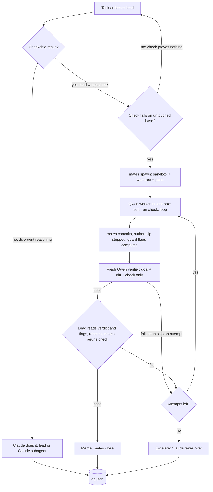

# Claude-led mates with local Qwen workers: design

Date: 2026-11-10. Status: draft for Wai's review.

## Revision 2026-11-10 (evening): two-pane mates — this section wins

Wai, verbatim:
- "mates opens two panes (at first) / claude code left / qwen opencode right /
  I want to be able to talk to qwen myself if I want to, otherwise claude
  messages opencode as me"
- "qwen own worktree, claude merges"
- "take a look at spire-trio / if I haven't run `mates` before, run it with
  1 qwen and 1 claude / if I have, restore the claude with N agents that were
  previously running"
- the Qwen-to-Claude question channel, plus "make sure qwen knows this"
- "add in the conventions that qwen has no internet, just so that it doesn't try"
- the 20-task pilot was skipped ("c")

What `mates` is now:

- **Panes.** Claude Code (the lead, a normal Claude session) on the left half.
  One or more `qwen` panes on the right: OpenCode on the local model, in the
  same bwrap sandbox as the `qwen` command. Wai can type into any pane.
- **Worktrees.** Each Qwen pane works in its own worktree of the repo, on
  branch `mates/qwen-<n>`, made from the lead's committed HEAD. The two never
  edit the same files.
- **Delegating.** Claude types the request into a Qwen pane as Wai (tmux
  send-keys), prefixed `[from Claude]`. Qwen's standing instructions
  (`bin/qwen-sandbox.md`) tell it that, for such messages, it writes
  `.mates/done.md` when finished or `.mates/question.md` when unsure, and does
  not commit. Claude waits on either file. It answers a question in the pane,
  or asks Wai when it is really Wai's call.
- **Merging.** Claude reads the diff in Qwen's worktree and runs the checks
  there. If they pass, it commits there and rebases onto its branch, then
  fast-forwards its branch and resets Qwen's worktree to the new HEAD.
  Otherwise it types notes back. After two failed tries, Claude does the task
  itself. Work Wai did with Qwen directly is merged the same way, on request.
- **Save and restore, as spire-trio does.** The first `mates` in a repo
  starts 1 Claude and 1 Qwen. Later runs restore the same Claude conversation
  and every Qwen pane that was open, each resuming its OpenCode session. The
  state is saved on every change, in `~/.claude/mates/sessions/<repo>.json`.
  `mates --fresh` starts over.
- **Routing, audit log, retro: unchanged.** Every routed task gets a log line,
  Claude-only tasks too, with questions and answers. The retro reads the log.
- **Retired (code stays on the branch):** the spawn queue, the blind Qwen
  verifier, red-on-base enforcement, and workers running as user `claude`. The
  right panes run as Wai inside bwrap. Claude's review of the diff and its own
  check run are the gate.
- **Still in force from below, after the adversarial review (late
  2026-11-10):**
  - Qwen-written code never runs as Wai before it is merged. The lead's
    check runs inside the same sandbox (`mates check`), and every git step on
    a Qwen worktree runs with hooks off.
  - In mates panes Qwen's git metadata is read-only, apart from its own
    worktree index, so it cannot move the lead's branch.
  - Checks get their tools from a tracked `.mates/runtime.sh`, built outside
    the sandbox and mounted read-only (the Runtimes channel 1 below).
  - What merges is the tree that passed the check.
  - One open task at a time until two panes are measured to work at once.
  - The hosaka lock, the cost fields in the log, and the guard flags.
  - The unattended retro sees no Qwen-written text, has no tools, and `mates`
    writes and checks its lessons.

## Intent

Wai is on a Claude Max subscription. The goal is to **get more work out of the
same usage limits by pushing everything that can be checked onto the local
GPU.** Claude stays the lead: it diagnoses, coordinates, comes up with ideas,
picks who does each task, and reviews. A local Qwen3.8-27B does the mechanical
work in visible tmux panes. This is global: it works in any repo, not only the
tower defense game that prompted it.

The shape comes from `~/bin/spire-trio` (`~/.claude/spire-trio.sh`): peer
Claude sessions in one tmux window that talk over ListAgents/SendMessage. The
difference here is that the lead **spawns workers on demand**, and the workers
run Qwen, not Claude.

## Priorities (Wai's, ordered)

> "main goals are (ordered) 1. PII security 2. output fidelity 3. cost-saving"

1. **PII security.** No private data leaves the machine through a worker, and
   a worker cannot reach data its task does not need.
2. **Output fidelity.** A change that merges is correct, and a pass means the
   check really passed.
3. **Cost-saving.** A delegation spends less Claude usage than doing the task
   solo.

When two of these pull apart, the higher one wins. A cheaper review that
lowers fidelity is out; a faster worker that widens data access is out.

## Routing rule (Wai's)

> "hand everything with a clear auditable outcome to Qwen / complex reasoning
> with divergent outcomes go to Claude"

- **Qwen:** a task with a pass/fail check: tests pass, build is clean, a grep
  or diff matches the brief, values come out as stated. Examples: mechanical
  edits, renames, wiring up an existing pattern, boilerplate and tests, docs
  from a given outline.
- **Claude** (the lead itself, or a Claude subagent): unclear bugs, design,
  mechanic ideas, tradeoffs, anything where reasonable answers differ.
- **Corollary (Claude's call):** if the lead cannot write the check, the task
  does not go to Qwen.
- **Escalation (from the research):** after two failed attempts on the same
  task, the lead takes it back. A claim of "done" with no passing check counts
  as a failed attempt.

## Goals

1. One command the lead runs to spawn a Qwen worker on a task, in its own git
   worktree and branch, in a new tmux pane.
2. Worker panes are **full interactive sessions**. Wai can type into one and
   steer it.
3. Layout: the lead keeps the **left half** of the window. Workers split the
   right half, with each pane **as close to a phone (portrait) shape as
   possible**.
4. Every routing decision is logged and can be audited, including the
   Claude-side cost of each delegation.
5. Works in any git repo, with no setup per repo.

## Non-goals

- No automatic router model. The lead (Claude) triages.
- No changing how Claude-only work runs today.
- Not a replacement for spire-trio's peer-session setup.

## Anti-goals (would make this a failure even if it runs)

- **Delegation that costs Claude more than it saves.** The delegate-local
  project measured 2,159 delegations and shut down in October 2026 for this
  reason: Claude spent more tokens briefing Qwen and reading back its text
  than Qwen saved. So **Qwen must act as an agent** (edit files, run the check
  itself) and return a short report, never text that Claude then applies.
- **Parallel bad work.** Wai: "always prefer slower good work over parallel
  bad work." One worker with enough context beats two starved ones.
- **Silent fallbacks.** A worker failure must never show up as a Qwen success.
  In Akita's benchmark, a failed executor was quietly redone by the frontier
  model.
- **A worker touching anything outside its worktree**, Wai's working tree, or
  the remote.
- **Private data leaving the machine through a worker**, or a worker reading
  secrets, credentials, or another repo's data. A permission prompt is not
  enough to stop this; the sandbox below is.
- **A pass that the worker produced by changing the check** or the tests it
  runs.

## Constraints (measured 2026-11-10)

| Item | Value |
|---|---|
| GPUs Ollama sees | RTX 5070 Ti 14.7 GiB free + GTX 1660 5.0 GiB free = **19.7 GiB** |
| `qwen3.8:27b` (Ollama default Q4) | 18 GB, 256K context window, image input |
| Room left for context (KV cache) | ~1.7 GB, **unmeasured**. Qwen 3.5+ uses mostly linear attention, which may make long context cheap (unverified) |
| Ollama settings | 0.30.0, `OLLAMA_CONTEXT_LENGTH=8192`, `NUM_PARALLEL=2`, `MAX_LOADED_MODELS=1`, `KEEP_ALIVE` = forever, flash attention on |
| Claude Code | 2.1.322 |
| Host RAM in WSL | 39 GB |
| Current local default | `gpt-oss:20b`; Qwen takes over its slot (one model loaded at a time) |

**GPU priority, Wai's call: Qwen wins over TTS.** Hosaka's server currently
runs `ollama stop gpt-oss:20b` on start. It must instead refuse to start, with
a clear message, while a mates worker is running.

## How it works

1. The lead triages a task with the routing rule and writes a log entry
   (`route`, `reason`).
2. For Qwen, the lead runs `mates spawn` with a brief: goal, files, constraints,
   and **the check command**.
3. `mates` runs the check on the untouched base first and refuses to spawn
   unless it fails there (see The check). It then creates a worktree and
   branch off the lead's current HEAD, opens a pane, and starts a worker
   there, inside the sandbox (see Threat model and sandbox): **Claude Code pointed at local Ollama**
   with Qwen as its model. Claude Code is the worker's harness, so Qwen gets
   the same file and shell tools; Ollama speaks the Anthropic API since
   January 2026. The brief is the worker's first message, and a mates-worker
   role is appended to its system prompt.
4. The worker edits, runs the check, and loops on its own until the check
   passes or it gives up. It then stops and writes `.mates/report.md` in
   the fixed short format: pass/fail, the check's output tail, and a diff
   stat. `mates`, running outside the sandbox, makes the commit on the task
   branch; the worker has no write access to the repo's `.git`. The report
   file is the only channel: the sandbox hides the SendMessage sockets that
   spire-trio uses. The pane stays up so Wai can scroll back or steer it.
5. **Independent Qwen review.** Wai: "always use another qwen instance to
   verify instead of the same one" and "obfuscate the fact the output was
   generated by another Qwen to minimize the bias". `mates` starts a **fresh
   Qwen session** as the verifier, with no shared context and in its own pane
   in the same tiling. It gets only:
   - the brief's goal,
   - the diff, and
   - `.mates/check.sh`.

   It never sees the worker's report, reasoning, or transcript. Authorship
   is stripped before the verifier sees anything:
   - the diff comes from a neutral `mates` commit with no co-author or model
     trailer;
   - code comments and strings that name a model or "AI" are flagged;
   - the brief calls it "a proposed change", never "Qwen's" or "another
     model's".

   The verifier reruns the check, reviews the diff against the goal, and
   writes `.mates/verdict.md` (pass/fail plus at most 5 findings). A fail goes
   back to the worker as notes and counts as an attempt.

   Caveat: only one model fits in VRAM, so the verifier runs the **same
   weights** in a separate context. The bias it removes comes from the fresh
   context and the hidden authorship, not from a different model.
6. The lead reads the verdict, the diff stat, and the guard flags `mates`
   computed from the diff (see The check). Any flag means the lead reads the
   full diff. The lead rebases the task branch, then `mates` reruns the check
   on the rebased tree inside the sandbox. It then either
   merges and logs `accepted`, or sends it back with notes (attempt 2), or
   takes it over and logs `escalated`.
7. `mates close` removes the pane and the worktree after merging, and logs the
   outcome with the cost fields.

### Layout

- The lead pane is pinned to 50% of the window width, on the left.
- Workers tile the right half in a grid of `c` columns by `r` rows (`c·r ≥ N`).
- Terminal cells are about twice as tall as wide. A 9:19.5 portrait phone
  shape is therefore a pane with **columns ≈ 0.92 × rows**. `mates` picks the
  grid whose panes' `cols/rows` is closest to 0.92, compared in log space.
  Example: a 240×60 window gives a 120×60 right half. One worker fills it
  (ratio 2.0, the best one pane can do). Two workers sit **side by side** at
  60×60 (ratio 1.0), not stacked (120×30, ratio 4.0).
- The layout is recomputed whenever a worker is added or closed, and when the
  window resizes, if tmux makes that cheap (builder's call).
- `mates` refuses to run outside tmux.

### Concurrency (Claude's call, under Wai's "slower good work" rule)

- **Default is one worker at a time.** A second spawn queues and starts when
  the first closes.
- `mates` allows two concurrent workers only if a measured test shows both get
  a **usable context (≥ 64K tokens) at once without spilling to CPU**. Ollama
  shares one loaded model between parallel requests, and each slot needs its
  own KV cache.
- **Never offload to CPU.** Each worker gets the context that fits on the GPU.

### Context and compaction (Claude's call)

- The worker's Claude Code system prompt and tools alone take a large share of
  context (the builder measures how much). Ollama's 8192 default is far too
  small. The mates model gets its own context setting (a Modelfile variant,
  e.g. `qwen3.8-mates`). Target **64K**; the floor is whatever the measured
  test proves fits at one worker. Below 32K, use the smaller Q3/IQ4 quant on
  the 5070 Ti alone instead.
- Worker Claude Code must compact against the **real** local window, not the
  200K it assumes for an unknown model. The builder finds the setting
  (environment variable or model config) and verifies compaction fires before
  Ollama truncates.
- Briefs stay small: one task, named files, one check. Over-scoping is the
  main way local models fail.

### Isolation and safety

- Worktrees are on a branch `mates/<task-id>` and live in a shared mates
  directory outside `/home/wai` (see Threat model and sandbox for why).
  Workers start in their worktree.
- Workers run with no Anthropic credentials: the login file is not visible
  inside the sandbox, `ANTHROPIC_API_KEY` is unset,
  `ANTHROPIC_BASE_URL` pointed at local Ollama, and every model slot (main,
  small/fast, subagent) set to the Qwen model. **No worker request may reach
  Anthropic.** The test confirms this.
- Never `--dangerously-skip-permissions`. Workers run in a permission mode
  that auto-accepts edits inside the worktree and allows the brief's check
  command. Anything else prompts in the pane, where Wai can see and answer it.
  Denied for workers: `git push`, WebFetch, WebSearch, and edits outside the
  worktree. These rules are the second layer. The sandbox is the guard.

### Threat model and sandbox (Claude's call, from the adversarial review)

The worker is untrusted. It writes code and tests, and the check runs them,
so anything the worker writes executes with the worker's rights. Permission
rules cannot hold that: a test file can read a secret or open a socket
without one tool call being prompted. Measured 2026-11-10: sessions run as
`wai`, the login file `~/.claude/.credentials.json` and `~/.secrets` are
readable by that user, and a token sits in the shell environment.

What must stay on the machine and out of a worker's reach:

| Data | Where |
|---|---|
| Raw personal data | emet `data/`, and any repo's ignored data files |
| Secrets and credentials | `~/.secrets`, `~/.ssh`, the Claude login file, tokens in the environment |
| Other repos | everything under `~/src` except the task's worktree |
| The lead's history | `~/.claude` transcripts and memory |

Wai's call, after the review: "move the qwens into a sandbox under the
unfortunately named claude user". So there are two kernel layers. Every
worker, every verifier, and every run of the check (the lead's rerun
included) runs **as the Unix user `claude`**, and inside a sandbox on top of
that. If either layer has a hole, the other still holds.

Measured 2026-11-10 for this: `claude` is uid 1001, in group `emetcode`,
and not in group `wai`. `/home/wai` is mode 750, so `claude` cannot enter it
at all. `wai` may run any command as `claude` without a password
(`sudo -u claude`). `bwrap` 0.9.0 is installed (Wai, 2026-11-10), and a
sandbox with an empty `/home` and only a loopback interface starts under
both `wai` and `claude`.

- **Unix user.** `mates` (running as `wai`) starts each worker with
  `sudo -u claude`. File permissions alone then keep it out of everything
  under `/home/wai`: secrets, the login file, the lead's history, every
  repo, and emet `data/`. Consequences the builder must handle:
  - Worktrees cannot sit under the repo. They go in a shared directory both
    users can reach, set up so `claude` writes and `wai` reads and writes
    (shared group, setgid, umask 002). The builder picks the path.
  - The worker config and the check script are copied into that directory
    by `mates`, owned by `wai` and not writable by `claude`. The worker
    cannot change them even with no sandbox at all.
  - The worktree's git metadata stays under `/home/wai`, so the worker has
    no git. `mates` does every git step as `wai`.
  - The pane runs the `sudo -u claude` command inside Wai's tmux, so Wai can
    still type into it.
- **Sandbox tool.** `bwrap`, and nothing else. It starts from an empty view
  and shows the worker only what is listed, so a forgotten line hides too
  much and breaks visibly. A hand-built `unshare` script starts from the
  full view and fails the other way, so it is not a fallback. The user
  switch does not replace the sandbox: `claude` has its own home, which may hold the
  login used by the walled emet sessions, and it has the network.
- **Filesystem.** The worktree is the only writable path. System directories
  and the worker config are read-only. No home directory is mounted, neither
  `/home/wai` nor `/home/claude`; the sandbox gets an empty one. The repo's `.git` is not writable, so a worker cannot plant
  a hook or change config that would later run outside the sandbox; `mates`
  commits from outside.
- **Network.** Its own network namespace. The one reachable endpoint is the
  local Ollama server, passed in through a forwarded socket. No DNS, no route
  out. This is what makes "no request leaves the machine" a property of the
  setup and not of one test run.
- **Environment.** Started from an empty environment plus a short allowlist
  (`PATH`, `HOME` pointing at the sandbox home, `TERM`, the Ollama settings).
  No tokens, and `MATES_LEAD` is not passed on.
- **Runtimes (Wai, 2026-11-10: "ensure that any necessary files are either
  in the worktree repo or (can be) injected by lauching claude").** The
  sandbox hides `/home/wai`, which takes with it a repo's `.venv`,
  `node_modules`, and tools under `~/.local`. Nothing a check needs may
  depend on that folder. A check gets what it needs through one of two
  channels, and through no other:
  1. **From the repo.** A tracked `.mates/runtime.sh` at the base commit.
     `mates` runs it as `wai`, outside the sandbox, with network, and
     points it at a runtime directory it should fill. Example:
     `UV_PROJECT_ENVIRONMENT=$MATES_RUNTIME/venv uv sync --frozen`, with uv's
     Python and cache also under `$MATES_RUNTIME`.
     - The script comes from the base commit, never from the worker's tree,
       so a worker cannot change it.
     - The result is cached in `/srv/mates/runtimes/<repo>/<hash>/`, where
       the hash covers the script plus the lockfiles it names. It is built
       once and reused by every later task until the lockfiles change.
     - It is mounted read-only in the sandbox, at the same absolute path it
       was built at, so paths baked into a venv still resolve. The script's
       `PATH` and env additions come with it.
  2. **Injected at launch.** `mates spawn --inject <path>[:<dest>]` (and a
     default list in the lead's launch config). `mates` copies the path, as
     `wai`, into the task's read-only `ctl/inject/` and mounts it at
     `<dest>`.
     - **Refused** for anything under `~/.ssh`, `~/.gnupg`, `~/.secrets`,
       `~/.claude`, `~/.config/gh`, any `.credentials*`, `.env*`, `*.pem`,
       or `*.key`, and anything holding a token the guard's secret scan
       finds.
     - Every injection is logged with its path and hash.

  The runtime is built outside the sandbox, and is therefore trusted code.
  That is why it may only come from the committed repo or from the lead's
  launch, never from the worker. If a check still finds a tool missing,
  red-on-base reports `runtime-missing` with the command that failed, so
  the lead can add the runtime script or an injection before spawning
  again.
- **Version.** The worker's Claude Code is pinned to the tested version with
  auto-update off. A new version is re-tested before workers use it.
- **No fallback.** If the sandbox cannot start, `mates spawn` fails. It never
  runs a worker outside it.

**What goes back to Claude.** The lead sends what it reads to Anthropic, so
the worker's output is the other way data can leave. By default the lead
gets fixed fields only: pass or fail, the diff stat, the guard flags, and
the last 20 lines of check output. It reads the full diff when a flag or the
verdict calls for it, which is the same code it would have written itself.
It does not read the worker's transcript.

**emet.** The kernel wall there stops the restricted `claude` user. The lead
runs as `wai`, who owns `data/`, so a worker running as `wai` would walk
straight past it. Running workers as `claude` puts them behind the same wall
as the walled emet sessions, and the sandbox adds a second barrier: `data/`
is not in the worktree and nothing else of the checkout is mounted. The
worker config also carries emet's deny rules as a third layer, since a
separate config directory would otherwise drop them.

## Audit log

One JSON line per task in `~/.claude/mates/log.jsonl`, plus `mates log` to print
a table, filterable by repo, route, and outcome.

| Field | Meaning |
|---|---|
| `ts`, `repo`, `task_id` | when, where, which |
| `summary` | one line, the lead's words |
| `route` | `qwen`, `claude-subagent`, or `claude-self` |
| `reason` | why that route, one line (routing-rule language) |
| `check`, `check_sha` | the pass/fail command and the hash of its script (Qwen routes) |
| `red_on_base` | whether the check failed on the untouched base; `--green-base` reason if not |
| `flags` | guard flags raised on the diff, and whether the lead read the full diff |
| `attempts`, `outcome` | `accepted`, `sent-back` (then the next attempt), `escalated`, `failed` |
| `answered_by` | the model that actually answered, read from the Ollama server's own record of the request (the worker's transcript only repeats the name it asked for), so silent fallbacks show |
| `worker_wall_s`, `worker_tokens` | Qwen's time and tokens (worker + verifier) |
| `verdict` | the fresh verifier's pass/fail and finding count, so audits can see how often the lead overturned it |
| `lead_tokens` | Claude's tokens spent briefing and reviewing this task (best estimate the builder can get from the lead's transcript) |

Claude-only routes get a log line too, so audits can catch tasks that should
have gone to Qwen. The point of the log is the cost-per-accepted-change
question: did a delegation save Claude usage once briefing and review are
counted?

## Daily retrospective

Wai: "I want Claude to run retrospectives daily to see how it can utilize the
subagents better."

- **When:** once a day, from a local cron or systemd user timer, so it can
  read the local log (a cloud routine cannot). It runs headless `claude -p`
  with a retro prompt. It is skipped on days with no new log lines, so idle
  days cost nothing.
- **What it reads:** that day's `log.jsonl` lines and the last seven retros.
  It does not read worker reports or transcripts: this run is unattended and
  sends what it reads to Anthropic, and text written by a worker must not
  steer the lead's prompt.
- **What it looks for:**
  - Misroutes: Claude routes that had a checkable result, and Qwen routes
    that escalated.
  - Cost per accepted change: `lead_tokens` against the Qwen work done.
  - Briefs that led to send-backs, and what they were missing.
  - Repeated failure patterns: task types Qwen keeps failing.
  - Idle GPU time while Claude did checkable work.
- **What it writes:** `~/.claude/mates/retros/YYYY-MM-DD.md` with a short
  table of findings and up to three concrete changes.
- **What it may change on its own (Claude's call):** the lead role's "routing
  lessons" list (worked examples: route X went to Qwen and passed; route Y
  should have stayed with Claude) and the brief template. These changes are
  committed in this repo with the retro's date. A lesson names a task type
  only, with no repo name, path, or file content, because this repo is
  pushed and the log covers private repos. The retro files themselves stay
  in `~/.claude/mates/retros/` and are never committed. A change to the routing rule
  itself, to concurrency, or to the model is written up as a proposal in
  `OPEN-QUESTIONS.md` for Wai, never applied.

## Two commands: `claude` stays plain, `mates` starts the lead

Wai: "I want the `claude` command to start claude without a crew, as usual
and the `mates` command to start claude integrated with a qwen".

- **`claude`** is untouched. No skill pointer, no appended prompt, no Qwen.
  Nothing in the global `~/.claude/CLAUDE.md` or settings changes.
- **`mates`** (in `~/bin`) starts a Claude lead in the current directory, in
  the same way spire-trio starts its roles. It appends the lead role (routing
  rule, brief template, review steps, the `mates` subcommands) with
  `--append-system-prompt` and sets `MATES_LEAD=1` in the session's
  environment. Extra arguments pass through to `claude`, for example `--resume`
  or `--model`.
- **tmux handling (Claude's call):**
  - Not in tmux: `mates` starts a tmux session named `mates`.
  - In tmux, in a window with only this pane: the window becomes the mates
    window.
  - In tmux, in a window with other panes: `mates` opens a new window.

  The lead always sits in the left half of its window.
- **Warm start (Claude's call):** `mates` begins loading the Qwen model in the
  background as soon as it launches, so the first spawn doesn't wait on a
  cold model load.
- The same command manages workers: `mates spawn | list | close | log |
  layout | retro`. These refuse to run unless `MATES_LEAD=1`, so a plain
  `claude` session can't spawn workers by accident.
- A mates-worker role prompt is appended to every worker's system prompt (as
  in spire-trio's `spire-roles/`): stay in the worktree, run the check,
  commit, report in the fixed short format, and stop.

## Pieces

| Piece | Where |
|---|---|
| `mates` script (spawn / list / close / log / layout) | this repo `mates/mates.sh`, symlinked as `~/bin/mates` |
| Worker role prompt + worker config | this repo `mates/worker.md`; installed config dir `~/.claude/mates/worker-config` |
| Lead role prompt | this repo `mates/lead.md`, appended by `mates` at launch (no global skill) |
| Runtime state | `~/.claude/mates/` (`log.jsonl`, `queue`, `running/`) |
| Mates model variant | Ollama Modelfile on `qwen3.8:27b` with the chosen context |
| Hosaka change | hosaka repo: refuse to start while a mates worker is running, instead of stopping the LLM |
| Audit log | `~/.claude/mates/log.jsonl` |

## Decided by Wai

Max plan; aim is more work per usage window using local resources. Routing
rule as quoted above; Claude triages; every choice logged for audit. Global,
not per-project. Workers in git worktrees. Workers are full sessions in tmux
panes. Lead takes the left half; workers split the rest, each pane as close
to phone-shaped as possible. Qwen wins over TTS for the GPU. Claude decides
the context and compaction settings, with slower good work preferred over
parallel bad work. Daily retrospectives. Qwen's own tests and reviews are
verified by a separate Qwen instance, never the one that wrote the change,
and the verifier is not told the change came from Qwen. Goals in order:
PII security, then output fidelity, then cost-saving. Qwen workers run in a
sandbox as the `claude` Unix user.

## Claude's calls (Wai can overturn)

- No-check-means-no-Qwen corollary; escalation after two failed attempts.
- One worker at a time by default; a second only after the measured test.
- Context target 64K, floor 32K, smaller quant below that; never CPU offload.
- Worker harness is Claude Code against Ollama, not Aider.
- The phone-shape math above (0.92 cols/rows target).
- Log location and fields.
- The sandbox and its properties; the check stored outside the worktree and
  required to fail first; the guard flags; fixed fields back to the lead.
- The pilot's size (20 tasks) and its three bars.

## Settled after the builder review (Claude's calls)

- **The check.** `mates spawn <brief-file> <check-command>`. Compound
  commands with pipes and `&&` are fine. The worker's allowlist gets the
  single rule `bash .mates/check.sh`. The worker must not be able to change
  what a pass means, so:
  - **The script is out of the worker's reach.** `mates` keeps the original
    in `~/.claude/mates/running/<task-id>/check.sh`, which the worker's user
    cannot read or write, and gives the worker a copy it cannot write,
    mounted read-only at `.mates/check.sh`. Its hash goes in the log.
  - **It must fail first.** `mates spawn` runs the check on the untouched
    base and refuses to spawn if it passes, because a check that already
    passes proves nothing about the change. A task whose check is green on
    the base (a pure refactor) needs `--green-base` with a reason, which is
    logged, and the lead reads its full diff.
  - **Guard flags.** After the worker stops, `mates` compares the diff with
    the brief and flags: a file changed that the brief did not name, a test
    file changed or deleted, a test skipped or an assertion removed, and
    anything under `.mates/`. Any flag means the lead reads the full diff.
  - **The rerun that counts** is the one `mates` runs from its own copy of
    the script, on the rebased tree, inside the sandbox.
  - **What merges is what was checked.** `mates` refuses the merge if the
    tree differs from the one that passed, unless the outcome is logged
    `escalated`. A quiet fix by the lead cannot show up as a Qwen success.
- **Async, with a file-based queue.** `mates spawn` returns at once with a
  task id. The worker writes `.mates/report.md` and then exits its loop. The lead waits with
  a Monitor until-loop on the report file and can keep working in the
  meantime. At the concurrency limit, `mates spawn` appends to
  `~/.claude/mates/queue`, and `mates close` starts the next job. No daemon.
- **Model.** `qwen3.8:27b` (18 GB) exists in the Ollama library (checked
  2026-11-10). The fallback is a community IQ4_XS/Q3 GGUF pulled from
  Hugging Face (~14–15 GB) that fits on the 5070 Ti alone.
- **The plan is gated on the measured test.** Phase 1 is the test, and the
  plan stops there and reports to Wai. Pass/fail is decided at that gate:
  - Tool calls fail, or Claude Code's own prompt leaves under 16K of working
    room: try a lighter harness at the same worktree, pane, and log
    interface (opencode, then Aider) before building on Claude Code.
  - Every harness fails: stop and report.
  - The sandbox test or the pilot misses its bar (see First step): stop and
    report. Nothing past the bare pilot script gets built before that.
- **Hosaka (repo `~/src/hosaka`, Wai's own; editing it is in scope).** Each
  running worker writes a lock file at `~/.claude/mates/running/<task-id>`,
  and hosaka refuses to start while any exist. In the other direction,
  following "Qwen wins vs TTS", `mates spawn` stops a running hosaka server
  first and logs that it did.
- **Egress bar: nothing leaves the machine from a worker.** This is first a
  privacy bar and second the usage-limit point. The sandbox's network
  namespace enforces it. The config below is the second layer:
  - Workers get their own `CLAUDE_CONFIG_DIR` (`~/.claude/mates/worker-config`)
    with no plugins, hooks, MCP servers, or login.
  - That config's CLAUDE.md is the worker role. The repo's own CLAUDE.md
    still loads, which is wanted.
  - `CLAUDE_CODE_DISABLE_NONESSENTIAL_TRAFFIC=1` is set to drop telemetry and
    update checks.
  - The test confirms it by trying to connect out from inside the sandbox,
    which must fail, and with an `ss`/log check during a worker run.
  - The sandbox cuts the worker off from the SendMessage sockets, so the
    report file is the only channel.
- **`lead_tokens` is a rough figure (within a factor of 2), not exact.** It
  sums the usage of the lead's turns that ran a `mates` command or read that
  task's diff or report, taken from the lead's transcript. A rough figure is
  enough because the audit asks whether a delegation saved Claude usage, and
  the Qwen side is usually many times larger.
- **Dirty tree and merging.**
  - The worktree branches from the lead's committed HEAD. `mates spawn` warns
    if the files named in the brief have uncommitted changes, so the lead
    commits first.
  - On accept, the lead rebases the worker branch onto its current branch
    and fast-forwards.
  - A conflict means the lead (Claude) resolves it or sends the task back.
  - `mates` never pushes; pushing stays the lead's normal decision.
- **Where the source lives.** In this repo under `mates/` (script,
  lead and worker roles), symlinked into `~/.claude/mates` and
  `~/bin/mates`. That follows the dotfiles rule: project tooling lives in its
  own repo and is symlinked in, the way `voice` points at hosaka. No change
  to `~/.claude/CLAUDE.md`, so plain `claude` stays as it is.
- **emet.** No exclusion. Workers run as the `claude` user, which the kernel
  wall stops, inside a sandbox that does not mount `data/` (see Threat model
  and sandbox). An earlier draft said the wall covered workers while they
  ran as `wai`; that was wrong, and it is why the user switch was added.

## Builder decides

- Script language and internals. Any worktree or pane cleanup on crash.
- The exact Claude Code env vars and settings for the Ollama backend and for
  the compaction window, verified on 2.1.322.
- How `lead_tokens` is estimated.

## First step: measured tests and a pilot, before building

1. `ollama pull qwen3.8:27b`: an 18 GB download.
2. Load it at 32K, 64K, and 128K context with one and with two parallel
   requests. Record VRAM on both GPUs, whether any layer lands on CPU, and
   tokens/s. Ollama allocates context per parallel slot, and the current
   `NUM_PARALLEL=2` doubles it, so the one-worker runs use 1.
3. Run one headless Claude Code task against it (a real edit plus a test run)
   in a scratch repo. Confirm the tool calls work and how many tokens Claude
   Code's own prompt takes.
4. **Sandbox test, run twice.** A script tries each of these, and every one
   must fail: read a canary file in `/home/wai`, read the Claude login file
   of either user, list another repo, read emet `data/`, connect to an
   outside host, resolve a hostname, write to the repo's `.git`, change
   `.mates/check.sh`. It also prints the user, which must be `claude`, and
   the environment, which must hold no token. The first run is as `claude`
   inside the sandbox. The second is as `claude` with the sandbox off, to
   show what the user switch holds on its own; there the file and git
   checks must still fail, and the network and `/home/claude` checks are
   expected to succeed, which is the part only the sandbox covers.
5. **Pilot: 20 real tasks.** Taken from this machine's git history, each with
   a check that fails before the change and passes after, run in shuffled
   order with a bare script (sandbox, worktree, worker, verifier, log; no
   layout, queue, or retro). The solo baseline is the same 20 tasks done by a
   Claude subagent in a fresh session, with its tokens measured.

The concurrency and context defaults above get set from the numbers in 2
and 3. The build goes ahead only if the pilot meets all three bars, in
priority order:

| Bar | Pass |
|---|---|
| PII security | step 4 fully passes, and zero outbound connections across all 20 runs |
| Output fidelity | zero false passes: no accepted change that the task's known-good check or a full-diff read shows to be wrong |
| Cost-saving | Claude tokens per accepted change at or below 50% of the solo baseline |

A miss on any bar stops the plan with a report to Wai.
