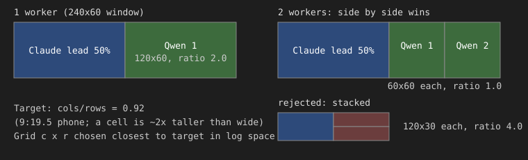

# Claude-led mates with local Qwen workers: design

Date: 2026-11-10. Status: draft for Wai's review.

## Intent

Wai is on a Claude Max subscription. The goal is to **get more work out of the
same usage limits by pushing everything that can be checked onto the local
GPU.** Claude stays the lead: it diagnoses, coordinates, comes up with ideas,
picks who does each task, and reviews. A local Qwen3.8-27B does the mechanical
work in visible tmux panes. This is global: it works in any repo, not only the
tower defense game that prompted it.

The shape comes from `~/bin/spire-trio` (`~/.claude/spire-trio.sh`): peer
Claude sessions in one tmux window that talk over ListAgents/SendMessage. The
difference here is that the lead **spawns workers on demand**, and the workers
run Qwen, not Claude.

## Routing rule (Wai's)

> "hand everything with a clear auditable outcome to Qwen / complex reasoning
> with divergent outcomes go to Claude"

- **Qwen:** a task with a pass/fail check: tests pass, build is clean, a grep
  or diff matches the brief, values come out as stated. Examples: mechanical
  edits, renames, wiring up an existing pattern, boilerplate and tests, docs
  from a given outline.
- **Claude** (the lead itself, or a Claude subagent): unclear bugs, design,
  mechanic ideas, tradeoffs, anything where reasonable answers differ.
- **Corollary (Claude's call):** if the lead cannot write the check, the task
  does not go to Qwen.
- **Escalation (from the research):** after two failed attempts on the same
  task, the lead takes it back. A claim of "done" with no passing check counts
  as a failed attempt.

## Goals

1. One command the lead runs to spawn a Qwen worker on a task, in its own git
   worktree and branch, in a new tmux pane.
2. Worker panes are **full interactive sessions**. Wai can type into one and
   steer it.
3. Layout: the lead keeps the **left half** of the window. Workers split the
   right half, with each pane **as close to a phone (portrait) shape as
   possible**.
4. Every routing decision is logged and can be audited, including the
   Claude-side cost of each delegation.
5. Works in any git repo, with no setup per repo.

## Non-goals

- No automatic router model. The lead (Claude) triages.
- No changing how Claude-only work runs today.
- Not a replacement for spire-trio's peer-session setup.

## Anti-goals (would make this a failure even if it runs)

- **Delegation that costs Claude more than it saves.** The delegate-local
  project measured 2,159 delegations and shut down in October 2026 for this
  reason: Claude spent more tokens briefing Qwen and reading back its text
  than Qwen saved. So **Qwen must act as an agent** (edit files, run the check
  itself) and return a short report, never text that Claude then applies.
- **Parallel bad work.** Wai: "always prefer slower good work over parallel
  bad work." One worker with enough context beats two starved ones.
- **Silent fallbacks.** A worker failure must never show up as a Qwen success.
  In Akita's benchmark, a failed executor was quietly redone by the frontier
  model.
- **A worker touching anything outside its worktree**, Wai's working tree, or
  the remote.

## Constraints (measured 2026-11-10)

| Item | Value |
|---|---|
| GPUs Ollama sees | RTX 5070 Ti 14.7 GiB free + GTX 1660 5.0 GiB free = **19.7 GiB** |
| `qwen3.8:27b` (Ollama default Q4) | 18 GB, 256K context window, image input |
| Room left for context (KV cache) | ~1.7 GB, **unmeasured**. Qwen 3.5+ uses mostly linear attention, which may make long context cheap (unverified) |
| Ollama settings | 0.30.0, `OLLAMA_CONTEXT_LENGTH=8192`, `NUM_PARALLEL=2`, `MAX_LOADED_MODELS=1`, `KEEP_ALIVE` = forever, flash attention on |
| Claude Code | 2.1.322 |
| Host RAM in WSL | 39 GB |
| Current local default | `gpt-oss:20b`; Qwen takes over its slot (one model loaded at a time) |

**GPU priority, Wai's call: Qwen wins over TTS.** Hosaka's server currently
runs `ollama stop gpt-oss:20b` on start. It must instead refuse to start, with
a clear message, while a mates worker is running.

## How it works

1. The lead triages a task with the routing rule and writes a log entry
   (`route`, `reason`).
2. For Qwen, the lead runs `mates spawn` with a brief: goal, files, constraints,
   and **the check command**.
3. `mates` creates a worktree and branch off the lead's current HEAD, opens a
   pane, and starts a worker there: **Claude Code pointed at local Ollama**
   with Qwen as its model. Claude Code is the worker's harness, so Qwen gets
   the same file and shell tools; Ollama speaks the Anthropic API since
   January 2026. The brief is the worker's first message, and a mates-worker
   role is appended to its system prompt.
4. The worker edits, runs the check, and loops on its own until the check
   passes or it gives up. It then commits on its branch and reports back to
   the lead in one short message: pass/fail, the check's output tail, and a
   diff stat. The report goes over SendMessage, the same channel spire-trio
   uses, if a worker session pointed at Ollama can reach it (see Builder
   decides). It stays up so Wai can scroll back or steer it.
5. **Independent Qwen review.** Wai: "always use another qwen instance to
   verify instead of the same one" and "obfuscate the fact the output was
   generated by another Qwen to minimize the bias". `mates` starts a **fresh
   Qwen session** as the verifier, with no shared context and in its own pane
   in the same tiling. It gets only:
   - the brief's goal,
   - the diff, and
   - `.mates/check.sh`.

   It never sees the worker's report, reasoning, or transcript. Authorship
   is stripped before the verifier sees anything:
   - the diff comes from a neutral `mates` commit with no co-author or model
     trailer;
   - code comments and strings that name a model or "AI" are flagged;
   - the brief calls it "a proposed change", never "Qwen's" or "another
     model's".

   The verifier reruns the check, reviews the diff against the goal, and
   writes `.mates/verdict.md` (pass/fail plus at most 5 findings). A fail goes
   back to the worker as notes and counts as an attempt.

   Caveat: only one model fits in VRAM, so the verifier runs the **same
   weights** in a separate context. The bias it removes comes from the fresh
   context and the hidden authorship, not from a different model.
6. The lead reads the verdict and the diff stat (the full diff only when they
   warrant it) and runs the check itself in the worktree. It then either
   merges and logs `accepted`, or sends it back with notes (attempt 2), or
   takes it over and logs `escalated`.
7. `mates close` removes the pane and the worktree after merging, and logs the
   outcome with the cost fields.

### Layout

- The lead pane is pinned to 50% of the window width, on the left.
- Workers tile the right half in a grid of `c` columns by `r` rows (`c·r ≥ N`).
- Terminal cells are about twice as tall as wide. A 9:19.5 portrait phone
  shape is therefore a pane with **columns ≈ 0.92 × rows**. `mates` picks the
  grid whose panes' `cols/rows` is closest to 0.92, compared in log space.
  Example: a 240×60 window gives a 120×60 right half. One worker fills it
  (ratio 2.0, the best one pane can do). Two workers sit **side by side** at
  60×60 (ratio 1.0), not stacked (120×30, ratio 4.0).
- The layout is recomputed whenever a worker is added or closed, and when the
  window resizes, if tmux makes that cheap (builder's call).
- `mates` refuses to run outside tmux.

### Concurrency (Claude's call, under Wai's "slower good work" rule)

- **Default is one worker at a time.** A second spawn queues and starts when
  the first closes.
- `mates` allows two concurrent workers only if a measured test shows both get
  a **usable context (≥ 64K tokens) at once without spilling to CPU**. Ollama
  shares one loaded model between parallel requests, and each slot needs its
  own KV cache.
- **Never offload to CPU.** Each worker gets the context that fits on the GPU.

### Context and compaction (Claude's call)

- The worker's Claude Code system prompt and tools alone take a large share of
  context (the builder measures how much). Ollama's 8192 default is far too
  small. The mates model gets its own context setting (a Modelfile variant,
  e.g. `qwen3.8-mates`). Target **64K**; the floor is whatever the measured
  test proves fits at one worker. Below 32K, use the smaller Q3/IQ4 quant on
  the 5070 Ti alone instead.
- Worker Claude Code must compact against the **real** local window, not the
  200K it assumes for an unknown model. The builder finds the setting
  (environment variable or model config) and verifies compaction fires before
  Ollama truncates.
- Briefs stay small: one task, named files, one check. Over-scoping is the
  main way local models fail.

### Isolation and safety

- Worktrees live in a mates directory per repo, on a branch `mates/<task-id>`.
  Workers start in their worktree.
- Workers run with no Anthropic credentials: `ANTHROPIC_API_KEY` unset,
  `ANTHROPIC_BASE_URL` pointed at local Ollama, and every model slot (main,
  small/fast, subagent) set to the Qwen model. **No worker request may reach
  Anthropic.** The test confirms this.
- Never `--dangerously-skip-permissions`. Workers run in a permission mode
  that auto-accepts edits inside the worktree and allows the brief's check
  command. Anything else prompts in the pane, where Wai can see and answer it.
  Denied for workers: `git push`, and edits outside the worktree.
- The walled emet setup on this machine is untouched. A worker in an emet
  checkout runs as the same user as the lead and hits the same wall.

## Audit log

One JSON line per task in `~/.claude/mates/log.jsonl`, plus `mates log` to print
a table, filterable by repo, route, and outcome.

| Field | Meaning |
|---|---|
| `ts`, `repo`, `task_id` | when, where, which |
| `summary` | one line, the lead's words |
| `route` | `qwen`, `claude-subagent`, or `claude-self` |
| `reason` | why that route, one line (routing-rule language) |
| `check` | the pass/fail command (Qwen routes) |
| `attempts`, `outcome` | `accepted`, `sent-back` (then the next attempt), `escalated`, `failed` |
| `answered_by` | the model that actually answered, read from the worker transcript, so silent fallbacks show |
| `worker_wall_s`, `worker_tokens` | Qwen's time and tokens (worker + verifier) |
| `verdict` | the fresh verifier's pass/fail and finding count, so audits can see how often the lead overturned it |
| `lead_tokens` | Claude's tokens spent briefing and reviewing this task (best estimate the builder can get from the lead's transcript) |

Claude-only routes get a log line too, so audits can catch tasks that should
have gone to Qwen. The point of the log is the cost-per-accepted-change
question: did a delegation save Claude usage once briefing and review are
counted?

## Daily retrospective

Wai: "I want Claude to run retrospectives daily to see how it can utilize the
subagents better."

- **When:** once a day, from a local cron or systemd user timer, so it can
  read the local log (a cloud routine cannot). It runs headless `claude -p`
  with a retro prompt. It is skipped on days with no new log lines, so idle
  days cost nothing.
- **What it reads:** that day's `log.jsonl` lines, the worker reports, and
  the earlier retros.
- **What it looks for:**
  - Misroutes: Claude routes that had a checkable result, and Qwen routes
    that escalated.
  - Cost per accepted change: `lead_tokens` against the Qwen work done.
  - Briefs that led to send-backs, and what they were missing.
  - Repeated failure patterns: task types Qwen keeps failing.
  - Idle GPU time while Claude did checkable work.
- **What it writes:** `~/.claude/mates/retros/YYYY-MM-DD.md` with a short
  table of findings and up to three concrete changes.
- **What it may change on its own (Claude's call):** the lead role's "routing
  lessons" list (worked examples: route X went to Qwen and passed; route Y
  should have stayed with Claude) and the brief template. These changes are
  committed in this repo with the retro's date. A change to the routing rule
  itself, to concurrency, or to the model is written up as a proposal in
  `OPEN-QUESTIONS.md` for Wai, never applied.

## Two commands: `claude` stays plain, `mates` starts the lead

Wai: "I want the `claude` command to start claude without a crew, as usual
and the `mates` command to start claude integrated with a qwen".

- **`claude`** is untouched. No skill pointer, no appended prompt, no Qwen.
  Nothing in the global `~/.claude/CLAUDE.md` or settings changes.
- **`mates`** (in `~/bin`) starts a Claude lead in the current directory, in
  the same way spire-trio starts its roles. It appends the lead role (routing
  rule, brief template, review steps, the `mates` subcommands) with
  `--append-system-prompt` and sets `MATES_LEAD=1` in the session's
  environment. Extra arguments pass through to `claude`, for example `--resume`
  or `--model`.
- **tmux handling (Claude's call):**
  - Not in tmux: `mates` starts a tmux session named `mates`.
  - In tmux, in a window with only this pane: the window becomes the mates
    window.
  - In tmux, in a window with other panes: `mates` opens a new window.

  The lead always sits in the left half of its window.
- **Warm start (Claude's call):** `mates` begins loading the Qwen model in the
  background as soon as it launches, so the first spawn doesn't wait on a
  cold model load.
- The same command manages workers: `mates spawn | list | close | log |
  layout | retro`. These refuse to run unless `MATES_LEAD=1`, so a plain
  `claude` session can't spawn workers by accident.
- A mates-worker role prompt is appended to every worker's system prompt (as
  in spire-trio's `spire-roles/`): stay in the worktree, run the check,
  commit, report in the fixed short format, and stop.

## Pieces

| Piece | Where |
|---|---|
| `mates` script (spawn / list / close / log / layout) | this repo `mates/mates.sh`, symlinked as `~/bin/mates` |
| Worker role prompt + worker config | this repo `mates/worker.md`; installed config dir `~/.claude/mates/worker-config` |
| Lead role prompt | this repo `mates/lead.md`, appended by `mates` at launch (no global skill) |
| Runtime state | `~/.claude/mates/` (`log.jsonl`, `queue`, `running/`) |
| Mates model variant | Ollama Modelfile on `qwen3.8:27b` with the chosen context |
| Hosaka change | hosaka repo: refuse to start while a mates worker is running, instead of stopping the LLM |
| Audit log | `~/.claude/mates/log.jsonl` |

## Decided by Wai

Max plan; aim is more work per usage window using local resources. Routing
rule as quoted above; Claude triages; every choice logged for audit. Global,
not per-project. Workers in git worktrees. Workers are full sessions in tmux
panes. Lead takes the left half; workers split the rest, each pane as close
to phone-shaped as possible. Qwen wins over TTS for the GPU. Claude decides
the context and compaction settings, with slower good work preferred over
parallel bad work. Daily retrospectives. Qwen's own tests and reviews are
verified by a separate Qwen instance, never the one that wrote the change,
and the verifier is not told the change came from Qwen.

## Claude's calls (Wai can overturn)

- No-check-means-no-Qwen corollary; escalation after two failed attempts.
- One worker at a time by default; a second only after the measured test.
- Context target 64K, floor 32K, smaller quant below that; never CPU offload.
- Worker harness is Claude Code against Ollama, not Aider.
- The phone-shape math above (0.92 cols/rows target).
- Log location and fields.

## Settled after the builder review (Claude's calls)

- **The check.** `mates spawn <brief-file> <check-command>`. `mates` writes the
  check command into `.mates/check.sh` in the worktree, which makes compound
  commands with pipes and `&&` fine. The worker's allowlist gets the single
  rule `bash .mates/check.sh`. The worker runs it while it works, and the lead
  reruns the same script before it accepts. The lead's rerun is the one that
  counts.
- **Async, with a file-based queue.** `mates spawn` returns at once with a
  task id. The worker writes `.mates/report.md` and then exits its loop; it
  also sends SendMessage if that works (the test checks). The lead waits with
  a Monitor until-loop on the report file and can keep working in the
  meantime. At the concurrency limit, `mates spawn` appends to
  `~/.claude/mates/queue`, and `mates close` starts the next job. No daemon.
- **Model.** `qwen3.8:27b` (18 GB) exists in the Ollama library (checked
  2026-11-10). The fallback is a community IQ4_XS/Q3 GGUF pulled from
  Hugging Face (~14–15 GB) that fits on the 5070 Ti alone.
- **The plan is gated on the measured test.** Phase 1 is the test, and the
  plan stops there and reports to Wai. Pass/fail is decided at that gate:
  - Tool calls fail, or Claude Code's own prompt leaves under 16K of working
    room: try a lighter harness at the same worktree, pane, and log
    interface (opencode, then Aider) before building on Claude Code.
  - Every harness fails: stop and report.
- **Hosaka (repo `~/src/hosaka`, Wai's own; editing it is in scope).** Each
  running worker writes a lock file at `~/.claude/mates/running/<task-id>`,
  and hosaka refuses to start while any exist. In the other direction,
  following "Qwen wins vs TTS", `mates spawn` stops a running hosaka server
  first and logs that it did.
- **Egress bar: zero model requests to Anthropic.** That is the usage-limit
  point, and it is enforced by config:
  - Workers get their own `CLAUDE_CONFIG_DIR` (`~/.claude/mates/worker-config`)
    with no plugins, hooks, MCP servers, or login.
  - That config's CLAUDE.md is the worker role. The repo's own CLAUDE.md
    still loads, which is wanted.
  - `CLAUDE_CODE_DISABLE_NONESSENTIAL_TRAFFIC=1` is set to drop telemetry and
    update checks.
  - The test confirms this with an `ss`/log check during a worker run.
  - A separate config dir may cut the worker off from the SendMessage
    sockets, so the report file is the main channel and SendMessage is extra.
- **`lead_tokens` is a rough figure (within a factor of 2), not exact.** It
  sums the usage of the lead's turns that ran a `mates` command or read that
  task's diff or report, taken from the lead's transcript. A rough figure is
  enough because the audit asks whether a delegation saved Claude usage, and
  the Qwen side is usually many times larger.
- **Dirty tree and merging.**
  - The worktree branches from the lead's committed HEAD. `mates spawn` warns
    if the files named in the brief have uncommitted changes, so the lead
    commits first.
  - On accept, the lead rebases the worker branch onto its current branch
    and fast-forwards.
  - A conflict means the lead (Claude) resolves it or sends the task back.
  - `mates` never pushes; pushing stays the lead's normal decision.
- **Where the source lives.** In this repo under `mates/` (script,
  lead and worker roles), symlinked into `~/.claude/mates` and
  `~/bin/mates`. That follows the dotfiles rule: project tooling lives in its
  own repo and is symlinked in, the way `voice` points at hosaka. No change
  to `~/.claude/CLAUDE.md`, so plain `claude` stays as it is.
- **emet.** No exclusion. A worker runs as the same user as the lead, so the
  kernel wall applies to it too, and workers only get the check command plus
  edits inside their worktree.

## Builder decides

- Script language and internals. Any worktree or pane cleanup on crash.
- The exact Claude Code env vars and settings for the Ollama backend and for
  the compaction window, verified on 2.1.322.
- How `lead_tokens` is estimated.

## First step: a measured test, before building

1. `ollama pull qwen3.8:27b`: an 18 GB download.
2. Load it at 32K, 64K, and 128K context with one and with two parallel
   requests. Record VRAM on both GPUs, whether any layer lands on CPU, and
   tokens/s.
3. Run one headless Claude Code task against it (a real edit plus a test run)
   in a scratch repo. Confirm the tool calls work, that no request leaves the
   machine, and how many tokens Claude Code's own prompt takes.

The concurrency and context defaults above get set from these numbers.
